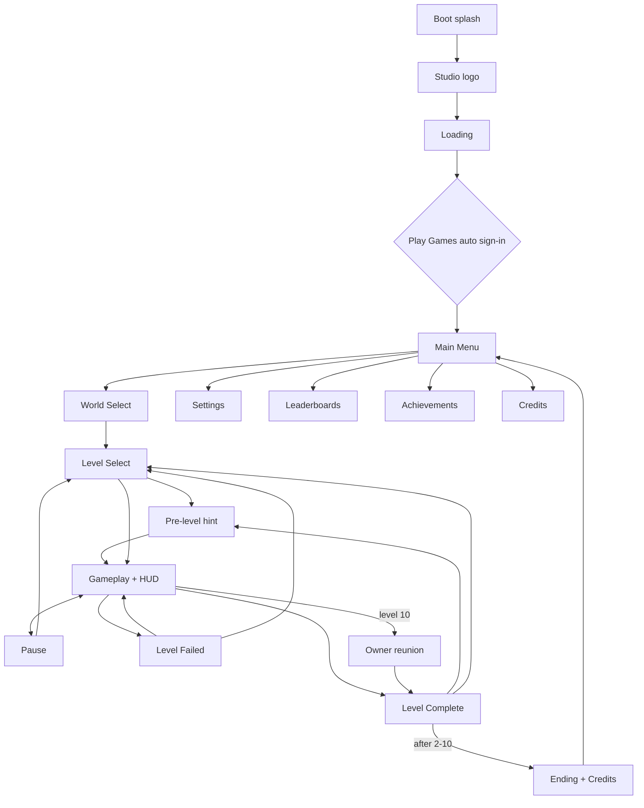

# wiwiwi — Production Plan (v1)

**Game:** wiwiwi · **Studio:** digicraft · **Engine:** Godot 4.7.2 (GDScript) · **Platform:** Android (Google Play)
**Package ID:** `com.digicraft.wiwiwi` — cannot change after the first upload.

> Facts marked **⚠ Verify** can change (store rules, plugin versions). Re-check before acting.
> Colors, fonts and art style are decided during development, not in this document.

## Contents
1. [Scope](#1-scope)
2. [Platform and Tech](#2-platform-and-tech)
3. [Gameplay Rules](#3-gameplay-rules)
4. [Screens and Flow](#4-screens-and-flow)
5. [Assets by Type](#5-assets-by-type)
6. [Tech Architecture](#6-tech-architecture)
7. [Google Services (no backend)](#7-google-services-no-backend)
8. [Android Export](#8-android-export)
9. [Testing](#9-testing)
10. [Release on Google Play](#10-release-on-google-play)
11. [Milestones M0–M5](#11-milestones-m0m5)
12. [Risks and Open Questions](#12-risks-and-open-questions)

---

## 1. Scope
- **v1:** 2 worlds × 10 levels. World 3 is a post-launch update.
- **Carried over from the prototype:** gentle energy + milk, owner reunion at the end of each world, stompable slimes, moving platforms.
- **New:** 3 hearts per level, checkpoints, 3-star rating, level select, settings, Play Games.
- **Not in v1:** coin shop, real-money purchases, ads, World 3, Hindi.
- **Prototype** (`cozy-cat-platformer`) is reference only. v1 is built fresh in `C:\Godot\Projects\wiwiwi`.
- **Design references:** level select + star reveal (Angry Birds), one-thumb controls + coin loop (Hill Climb Racing), themed worlds + hidden collectibles + checkpoints (Lep's World). Structure only, nothing copied.

## 2. Platform and Tech
| Item | Decision |
|---|---|
| Store | Google Play — **AAB** for upload, **APK** for testing |
| Target API | 36 (Play requirement since 31 Aug 2026). Godot 4.7 default — confirmed in our first APK. |
| Min Android | 7.0 (API 24, Godot default) |
| Orientation | Landscape only (Sensor Landscape) |
| Resolution | Base 1920×1080, stretch `canvas_items`, aspect `expand` |
| Screen shapes | Wider phones show more world sideways; tablets show more above/below. All UI inside a **SafeArea** container (notches, edge-to-edge). |
| Renderer | Compatibility (widest low-end support), target 60 FPS |
| Input | Touch only: left, right, jump, pause |
| Text | All strings through `tr()` + CSV, ready for more languages |

## 3. Gameplay Rules
- **Controls feel:** acceleration/deceleration, variable jump height, coyote time, jump buffer. Numbers tuned in M1.
- **Failing:** spikes, pits, enemy side-hits cost 1 heart → respawn at last checkpoint. 0 hearts → Level Failed.
- **Energy:** drains slowly while moving; milk refills it; at 0 the cat is slower, never a fail.
- **Stars:** ★ reach the goal · ★★ collect ≥ 80% of coins · ★★★ find the hidden Golden Yarn.
- **Levels:** 1–3 teach, 4–7 combine, 8–9 challenge, 10 finale + owner reunion. 60–150 s each.
- **Enemies:** World 1 slime; World 2 one new enemy + one new hazard.
- **Level data:** each level = a scene + a small `LevelData` resource (id, world, scene path, hint). A `level_catalog` lists them in order; menus and unlocks read only from it.
- **Save:** local versioned `user://save.json` (progress, coins, stats) with safe writes and migrations; `user://settings.cfg` for device settings. The save already has `wallet` and `cosmetics` fields so a shop needs no migration later.

## 4. Screens and Flow

| Screen | Owner scene |
|---|---|
| Logo, Loading | `ui/screens/logo_screen.tscn`, `loading_screen.tscn` |
| Main Menu | `ui/screens/main_menu.tscn` |
| World Select, Level Select | `ui/screens/world_select.tscn`, `level_select.tscn` |
| Pre-level hint | `ui/screens/level_intro.tscn` |
| HUD (hearts, coins, yarn, energy, pause, touch controls) | `ui/hud/hud.tscn` |
| Pause, Level Complete, Level Failed | `ui/screens/pause_menu.tscn`, `level_complete.tscn`, `level_failed.tscn` |
| Settings (music, sound, control size/opacity, screen shake, language, Play Games, reset progress) | `ui/screens/settings.tscn` |
| Credits | `ui/screens/credits.tscn` |
| Owner reunion | `scenes/objects/owner/owner.tscn` |

**Android Back button:** every screen handles it (gameplay → pause, menus → previous screen, main menu → "leave?" dialog). No Quit button on Android.

## 5. Assets by Type
Sources: **Self** = we draw/record · **CC0** = Kenney packs as a base, restyled · **OFL** = open fonts · **AI** = ElevenLabs (⚠ commercial rights depend on plan).
P0 = needed for the vertical slice (M2) · P1 = needed for launch · P2 = nice to have.

| Type | Items | Source | Priority |
|---|---|---|---|
| Cat animations | idle, run, jump, fall, land, hurt (P0); collect, sleepy, win (P1) — sprite sheets for AnimatedSprite2D | Self | P0/P1 |
| Owner | idle, wave, hug (cutscene via AnimationPlayer) | Self | P1 |
| Enemies | W1 enemy (P0), W2 enemy (P1) | Self | P0/P1 |
| Tilesets | 1 per world, TileMapLayer + terrains | CC0 base, restyled | P0/P1 |
| Backgrounds | 3–4 parallax layers per world (Parallax2D) | CC0 base + Self | P0/P1 |
| Objects | coin, golden yarn, milk bowl, checkpoint, goal door, spikes, platforms (one-way, moving, crumbling), decorations | Self / CC0 | P0/P1 |
| FX | sparkle, dust, confetti (CPUParticles2D textures) | Self | P0/P1 |
| UI | 9-slice buttons and panels, icon set, star icons, touch-control art, world cards | Self / CC0 | P0 |
| Fonts | 1 display + 1 UI font, open license, embedded with license file | OFL | P0 |
| Music | menu theme, 1 loop per world | AI / composer | P0/P1 |
| SFX | player, world, UI sounds | AI / CC0 / generated | P0 |
| Store assets | 512 icon, adaptive icon layers, feature graphic, screenshots, boot splash | Self | P1 |

**Folders:** `assets/art/{characters,enemies,objects,tiles,backgrounds,ui,fx}`, `assets/audio/{music,sfx}`, `assets/fonts` (+ `licenses/`), `data/`, `scenes/`, `ui/`, `autoload/`, `localization/`.
**Naming:** `snake_case` files, `PascalCase` nodes, prefixes `bg_`, `tiles_`, `fx_`, `ui_`, `mus_`, `sfx_`. No spaces or dates in names.

## 6. Tech Architecture
| Autoload | Job |
|---|---|
| `Events` | Global signal bus (coins, hearts, level results, achievement progress) |
| `GameState` | Current level, running attempt, level catalog, unlocks |
| `SaveManager` | Local save + settings, versions, migrations, cloud merge |
| `AudioManager` | Music crossfade, SFX pool, buses (Master → Music / SFX / UI) |
| `SceneTransition` | Fades between scenes, async loading |
| `PlayServices` | Wrapper for Play Games; does nothing on PC or when signed out |
| `Economy` *(future slot)* | Wallet + coin shop; hidden behind a feature flag in v1 |

- **Signals:** objects talk to parents locally; anything global goes through `Events`. Achievements are data-driven and tracked by one listener.
- **Levels:** `level_base.tscn` (camera, parallax, tiles, objects, spawn, goal, HUD); each level **inherits** it and only adds tiles and objects.
- **Performance:** texture atlases; lossless for UI/characters, VRAM-compressed (ETC2/ASTC) for large backgrounds; CPUParticles2D only, capped; enemies off-screen are disabled; one world's assets loaded at a time; AAB target < 80 MB.

## 7. Google Services (no backend)
**We run no backend of our own:** no servers, no database, no user accounts. Progress lives on the device. Everything online uses Google Play's prebuilt services.

### 7.1 Google Play Games Services — v1
- **What it's for:** sign-in, achievements, leaderboards, cloud save. **Not for payments.**
- **Sign-in:** automatic at launch (PGS v2); a manual "Sign in" button only if it fails or the player declines. The game works fully when signed out.
- **v1:** sign-in, ~12 achievements, 2 leaderboards. **v1.1:** cloud save (Saved Games/snapshots) using our existing save file.
- **Plugin:** `godot-play-game-services` v3.4.0 (github.com/godot-sdk-integrations, MIT). **Verified on Godot 4.7.2 on a real phone (M0).** Needs a Gradle build and a Play Games game ID in the export preset.
- **Setup:** create the app in Play Console → upload a build to internal testing → create the Play Games project → add credentials (SHA-1 of signing keys) → create achievements/leaderboards → add testers → put the game ID in export settings → publish with the release.

### 7.2 Google Play Billing — future slot (not in v1)
- **What it's for:** real-money purchases (e.g. cosmetic packs) and subscriptions. **Not used in v1.**
- **Kept ready by:** the `Economy` autoload and save fields. A coin shop using only earned coins needs no Billing at all.
- **When added:** Google Play Billing Library via a Godot plugin (⚠ choose and verify the maintained plugin at that time); purchases are verified by Google Play, still no backend of our own. Adds Play Console products and a Data safety update.

## 8. Android Export
- [x] Godot 4.7.2 export templates · JDK 17 · Android SDK (platform-tools, build-tools 35.0.1, platforms 35 + 36, command-line tools, CMake 3.10.2, NDK r28b)
- [x] Export preset: package, version code/name, arm64 + armv7, immersive, landscape
- [x] Gradle build on (needed for plugins and AAB)
- [x] Release (upload) keystore `C:\Godot\Keys\wiwiwi-upload.keystore`, alias `upload`, valid to 2054; password only in Godot's ignored `export_credentials.cfg` (back up the file in 2 places)
- Certificate SHA-1 (public, for Play Games credentials): upload `3A:5B:4F:6F:9C:87:32:A5:99:D1:B2:3A:B7:A0:06:88:2B:F6:E4:49` · Godot debug `76:EA:46:81:AC:A0:5C:A5:6A:D6:A1:7E:D3:DA:E8:64:8F:E3:12:08` · app signing key: from Play Console after the first upload
- [x] Signed release AAB builds (`Android Release (AAB)` preset, ~53 MB)
- [ ] Play App Signing enrolled on first upload
- [ ] Debug build adds x86_64 only for the emulator; release stays ARM

## 9. Testing
- **Devices:** **Samsung Galaxy M11** (Android 12, 720×1560, punch-hole camera, Adreno 506) = our real low-end test phone, connected by wireless debugging. Android Emulator for other shapes (20:9, tablet). Play Console **pre-launch report** and **closed-test testers' phones** before release.
- **Emulator limits:** FPS is not realistic (uses the laptop GPU), and the mouse is one finger only. Performance and multi-touch are checked on the M11.
- **Each milestone:** feel test with 3–5 players, level checks (completable, no soft-locks), save tests (kill app mid-save, migrations), interruption tests (home button, screen off → auto-pause), Play Games signed in/out/offline, 10-min performance run on the slowest device.
- **Before release:** Play Console pre-launch report.

## 10. Release on Google Play
- [ ] Personal developer account ($25)
- [ ] Privacy policy page (required even with no data collected)
- [ ] Data safety form (we collect nothing ourselves; include what the Play Games SDK does)
- [ ] Content rating, target audience (⚠ under-13 → Families policy), ads: none
- [ ] Store listing: texts, icon, feature graphic, screenshots
- [ ] **Closed test: ≥ 12 testers opted in for 14 continuous days** (personal accounts after Nov 2023), then apply for production access
- [ ] Staged rollout 20% → 100%; watch crashes/ANRs for 2 weeks

## 11. Milestones M0–M5
Estimates are combined focused hours. At **[X] h/week**: weeks = hours ÷ X (≈ 22 weeks at 20 h/week).

### M0 — Setup and export test (≈ 30 h)
- [x] Fresh project + local Git repo
- [x] Project settings, folders, empty autoloads, translation CSV
- [x] Android toolchain + debug APK (target SDK 36, landscape, no permissions)
- [x] SafeArea container + device-check screen
- [x] APK runs on a real phone (Galaxy M11): 60 FPS, landscape lock, punch-hole detected and avoided, fade works
- [x] Multi-touch check on the M11 (3 fingers detected)
- [ ] Emulator check for 20:9 + tablet shapes
- [x] Game name: **wiwiwi**
- [x] Studio name **digicraft** → package ID `com.digicraft.wiwiwi` (not used on Google Play as of 29 Oct 2026)
- [ ] Release keystore + Play Console account + internal testing upload (AAB via Gradle)
- [x] Gradle build + Play Games plugin v3.4.0 (MIT) loads on the phone with Godot 4.7.2; `PlayServices` wrapper reports signed_out gracefully
- [x] Play Games project created (Cloud project "wiwiwi"); game ID `254276654194` in both export presets
- [ ] Play Games: real sign-in on the phone (needs Play Console + real game ID)
- [ ] First AAB export (with real package ID + release keystore)
- [ ] Check ElevenLabs commercial rights for existing audio
- [ ] GitHub repo for the new project

### M1 — Prototype, greybox (≈ 70 h)
- [ ] Player controller v2 + camera
- [ ] Greybox tileset, `level_base`, `LevelData` + catalog
- [ ] Hearts, checkpoints, respawn, coins, golden yarn, goal, stars
- [ ] Energy + milk; slime, spikes, pits, platforms
- [ ] Touch controls in SafeArea
- [ ] 3 greybox levels; playtest and tune; performance check

### M2 — Vertical slice (≈ 110 h)
- [ ] Art direction decided (colors, fonts, style); Theme resource
- [ ] Final cat animations, World 1 tileset + parallax, core objects
- [ ] All screens + transitions + Back button
- [ ] SaveManager v1, AudioManager + core SFX, juice pass
- [ ] Play Games: sign-in + 1 leaderboard + 2 achievements
- [ ] 3 polished World 1 levels; playtest

### M3 — Content (≈ 130 h)
- [ ] World 1 levels 4–10 + owner reunion
- [ ] World 2 tileset, parallax, enemy, hazard, levels 1–10
- [ ] Remaining animations, music, SFX
- [ ] All achievements + leaderboards (+ offline queue)
- [ ] `Economy` future slot (hidden)
- [ ] Level checks for all 20 levels

### M4 — Polish + closed test (≈ 60 h)
- [ ] Juice, settings (control size/opacity, screen shake), performance pass
- [ ] Bug bash, save + interruption tests, balance
- [ ] Real-device sign-off: pre-launch report + testers' phones (performance, multi-touch)
- [ ] Privacy policy + Data safety draft
- [ ] Start closed test (≥ 12 testers, 14 days) and fix feedback

### M5 — Release (≈ 35 h + review wait)
- [ ] Store assets and texts
- [ ] Content rating, target audience, Data safety
- [ ] Apply for production access; final AAB; staged rollout; monitor

## 12. Risks and Open Questions
| Risk | Mitigation |
|---|---|
| Play Games plugin breaks in a future Godot update | Proven on 4.7.2 (M0); pin Godot 4.7.x until launch |
| 14-day / 12-tester closed test | Recruit 15–20 testers early; start in M4 |
| Keystore loss | Play App Signing + 2 backups |
| AI audio not licensed for commercial use | Check in M0; regenerate or replace |
| No real device | Emulator for development; Play pre-launch report + closed-test phones for real-device checks (M4) |
| Art bottleneck / scope creep | CC0 bases; new ideas go to a v1.1 list |

**Open:** hours per week · target audience (13+ or including kids) · ElevenLabs plan · who owns art vs code · privacy policy hosting.
