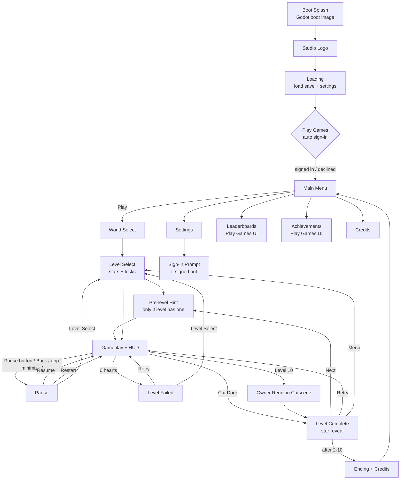

# [GAME NAME] — Production Plan (v1)

**Studio:** [STUDIO NAME] · **Engine:** Godot 4.7.2 (GDScript) · **Platform:** Android (Google Play) · **Status:** Draft for approval
**Package ID:** `com.[studio].[game]` (lowercase, no spaces — **cannot be changed after the first upload**)

> How to read this: each section is short and practical. Anything marked **⚠ Verify** is a fact that can change (store rules, plugin versions, licenses). Check it again right before you act on it.

---

## Table of Contents
1. [Prototype Review](#1-prototype-review)
2. [Vision and Pillars](#2-vision-and-pillars)
3. [Benchmark Lessons](#3-benchmark-lessons)
4. [Platform and Tech Constraints](#4-platform-and-tech-constraints)
5. [Gameplay Design](#5-gameplay-design)
6. [Worlds, Levels and Stars](#6-worlds-levels-and-stars)
7. [Progression and Save System](#7-progression-and-save-system)
8. [Screens and Flow](#8-screens-and-flow)
9. [Visual Style Guide](#9-visual-style-guide)
10. [Typography](#10-typography)
11. [Asset Plan](#11-asset-plan)
12. [Animation and Juice Plan](#12-animation-and-juice-plan)
13. [Audio Plan](#13-audio-plan)
14. [Tech Architecture](#14-tech-architecture)
15. [Google Play Games Services](#15-google-play-games-services)
16. [Mobile Performance Rules](#16-mobile-performance-rules)
17. [Android Export Checklist](#17-android-export-checklist)
18. [Testing Plan](#18-testing-plan)
19. [Google Play Release Checklist](#19-google-play-release-checklist)
20. [Milestones and Tasks (M0–M5)](#20-milestones-and-tasks-m0m5)
21. [Risks](#21-risks)
22. [Open Questions](#22-open-questions)
23. [Verified Facts and Sources](#23-verified-facts-and-sources)

---

## 1. Prototype Review

The prototype (`cozy-cat-platformer`, 16 scenes, 9 scripts) is our **reference**, not our codebase. We start a **fresh project** in M0 and copy over only the good ideas.

| Area | What the prototype has | What we do in v1 |
|---|---|---|
| Character | Cat with run, jump, gravity, squash/stretch, 5 animations (64 px) | Redraw at 1080p scale. New controller with coyote time, jump buffer, variable jump. |
| Energy | Drains 2/s; milk bowls refill; at 0 the cat respawns | **Keep, gentler:** at 0 the cat gets *sleepy* (slower), it never fails you. |
| Hazards | Spikes = sad meow + full restart; pits/slimes = respawn | **Spikes, pits, slimes cost 1 heart** and respawn you at the last checkpoint. |
| Enemies | Slime: patrol, ledge/wall/spike turn, stomp | Keep the behaviour. Redraw. Add 1 new enemy per world. |
| Platforms | One-way platforms, moving platform (AnimationPlayer) | Keep both. Levels now use **TileMapLayer** tilesets. |
| Finish | Owner girl: hug, hearts, confetti, jingle | Becomes the **end-of-world reunion** (levels 10 and 20). Normal levels end at a **Cat Door**. |
| UI | Score, energy bar, level label, win text; touch buttons | Rebuild with a Theme, real fonts, safe areas, settings for control size/opacity. |
| Audio | Music autoload; meows; coin/jingle SFX | Music autoload grows into **AudioManager** with buses. Reuse the ElevenLabs meows/music **if the license allows (see §13)**. |
| Settings | Godot default 1152×648, no orientation, no save, no export preset | 1920×1080, landscape lock, save system, Android export preset. |

**Reusable ideas:** one scene per object, signals between objects, groups for lookups, the Owner hug sequence, the touch-control layout.
**Rebuild:** all art at 1080p, all levels, all UI, the player controller, the whole flow around gameplay.

---

## 2. Vision and Pillars

**Pitch:** A little cat finds her way home across cozy worlds, collecting coins, sipping milk, and dodging gentle dangers — until she is reunited with her owner at the end of each world.

| Pillar | What it means in practice |
|---|---|
| **Cozy, never cruel** | Soft colors, kind failure (hearts + checkpoints), no timers that punish. |
| **One-thumb friendly** | Big buttons, forgiving jumps (coyote time, jump buffer), short levels. |
| **Juicy and readable** | Every action has a small reaction (sound, squash, sparkle). Hazards are easy to read at a glance. |
| **Small team, finishable** | 2 worlds × 10 levels for v1. Reuse scenes. Data-driven levels. |

---

## 3. Benchmark Lessons

We study structure and polish only. **No art, assets, names or level layouts are copied.**

### Angry Birds
| Adopt | Why it suits us |
|---|---|
| Level-select grid with **stars shown under each level** | Players see progress and want to "go back for 3 stars". Cheap to build. |
| **Star reveal sequence** on Level Complete (stars pop in one by one, with sound) | The single most rewarding moment. Pure UI + audio, no new art. |
| **Instant retry** button everywhere | Short loop; no frustration. |
| Clean, minimal HUD | Keeps small phone screens readable. |
| *Skip:* physics destruction, slingshot | Not our genre. |

### Hill Climb Racing
| Adopt | Why it suits us |
|---|---|
| **Two big thumb zones** for controls | Our left/right + jump layout follows this idea. |
| **Coins as a meta currency** with an upgrade/cosmetics shop | We design the slot now (off in v1), switch on in v1.1. |
| "**One more run**" pacing: fail → retry in 1 tap | Fast Level Failed → Retry. |
| Simple progress readout (distance) | Optional HUD progress bar (cat icon moving to the door). |
| *Skip:* fuel timer pressure, ads | Not cozy; no monetization in v1. |

### Lep's World
| Adopt | Why it suits us |
|---|---|
| **Themed worlds**, each with its own tileset and music | 2 worlds in v1, World 3 post-launch. |
| **Hidden collectible per level** | Our **Golden Yarn Ball** = the 3rd star. Rewards exploration, not speed. |
| **Checkpoints** mid-level | Fits our hearts system. |
| Stompable enemies, classic pacing (1–3 min levels) | Matches our slime. |
| *Skip:* heavy power-up set, ads, lives economy | Too much scope / not cozy. |

---

## 4. Platform and Tech Constraints

| Item | Decision |
|---|---|
| Store | Google Play. Upload **AAB**; use **APK** for device testing. |
| Target API | **Android 16 / API 36** for new apps and updates (deadline 31 Aug 2026 has passed). Godot 4.7 is reported to target 36 by default. **⚠ Verify in the built AAB manifest.** |
| Orientation | Landscape only. Project setting `display/window/handheld/orientation` = **Sensor Landscape** (landscape both ways, never portrait). |
| Base resolution | **1920×1080**, stretch mode `canvas_items`, aspect `expand`. |
| Wider phones (19.5:9, 20:9) | `expand` shows **more world left/right**. Gameplay stays the same; HUD sticks to edges. |
| Taller screens (4:3 tablets, 16:10) | `expand` shows **more world above/below**. Camera limits stop showing empty space. |
| Notches / cut-outs / nav bar | Apps targeting API 35+ draw **edge-to-edge**. A `SafeArea` container reads `DisplayServer.get_display_safe_area()` and pads all HUD/menus. **⚠ Verify on a notched device.** |
| Renderer | **Compatibility** (OpenGL ES 3). Widest device support; best for low-end phones. (Mobile renderer needs Vulkan.) |
| Frame rate | Stable **60 FPS** on a mid-range phone; physics tick 60. |
| Input | Touch only. On-screen Left / Right / Jump + Pause. |
| Monetization | None in v1. Architecture has an `Economy` + `Shop` slot behind a feature flag. |
| Language | English only in v1. **All text through `tr()`** + a CSV translation table, ready for Hindi. |

---

## 5. Gameplay Design

### Core loop
`Choose level → run & jump → collect coins/yarn, drink milk, avoid hazards → reach Cat Door → see stars → next level` · every 10th level: **Owner reunion**.

### Player abilities and feel targets
| Ability | Target value (start point, tune in M1) |
|---|---|
| Run speed | 520 px/s (≈ prototype speed scaled to 1080p) |
| Acceleration / deceleration | 0.08 s to full speed / 0.06 s to stop (snappy) |
| Jump height | ~3 tiles (192 px at 64 px tiles) |
| **Variable jump** | Releasing Jump early cuts upward speed by 50% → short hops |
| **Coyote time** | 0.10 s — you can still jump just after walking off a ledge |
| **Jump buffer** | 0.12 s — pressing Jump just before landing still jumps |
| Max fall speed | 1400 px/s (keeps falls readable) |
| Stomp bounce | 70% of jump; 60 ms hit-stop |
| Landing | Squash + dust puff |

### Failure: hearts + checkpoints
- 3 hearts per level. Spikes, pits and enemy side-hits cost **1 heart** → respawn at last checkpoint with 1 s blink (invincible).
- 0 hearts → **Level Failed** screen (Retry / Level Select). Coins collected that attempt are not saved.
- **Checkpoint:** a cat cushion, 1–2 per level. Touch = sparkle + "purr" sound.

### Energy (gentle)
- Drains slowly **only while moving** (≈ 1%/s). Milk bowls refill +50.
- At 0: cat is **sleepy** (−35% speed, −15% jump, "Zzz" particles). **Never a fail state.**

### Enemies and hazards (v1)
| World | New this world | Behaviour |
|---|---|---|
| W1 Sunny Meadow | Slime, spikes, pits, moving platforms | Slime patrols, turns at ledges/walls/spikes; stompable. |
| W2 Sunset Town | Pigeon (flies on a `Path2D`), crumbling roof tiles | Pigeon is stompable; crumbling tile falls 0.6 s after you land. |

---

## 6. Worlds, Levels and Stars

### Content for v1
| World | Levels | Mood | Ends with |
|---|---|---|---|
| 1 · Sunny Meadow | 1-1 … 1-10 | Morning, soft blue sky, green grass | Owner reunion in 1-10 |
| 2 · Sunset Town | 2-1 … 2-10 | Rooftops, pink/orange sunset | Owner reunion in 2-10 + "Home" ending |
| 3 · Snowy Night | Post-launch | Night, warm windows | — |

### Difficulty curve (per world)
| Levels | Purpose |
|---|---|
| 1–3 | Teach one new thing each (with a hint card) |
| 4–7 | Combine things; introduce the world's new enemy |
| 8–9 | Challenge; longer, more hazards, golden yarn well hidden |
| 10 | Finale + reunion cutscene |

Target length: **60–150 s** per level for a first clear.

### 3-star rule (simple and cozy — no timers)
| Star | Rule |
|---|---|
| ★ | Reach the Cat Door |
| ★★ | Collect **at least 80%** of the level's coins |
| ★★★ | Find the level's hidden **Golden Yarn Ball** |

Best result per level is kept (stars never go down). World 2 unlocks when 1-10 is cleared (no star gate in v1).

### Level data format
Each level = one scene + one small data resource:
```
data/levels/w1_03.tres   (LevelData resource)
  id            = "w1_03"
  world         = 1
  index         = 3
  title_key     = "LEVEL_W1_03_TITLE"   # translated text key
  scene_path    = "res://scenes/levels/w1/level_w1_03.tscn"
  hint_key      = "HINT_MOVING_PLATFORMS"  # optional pre-level hint
  par_time      = 90.0                  # for stats only, not stars
  coin_total    = (auto-counted at load)
  is_reunion    = false
```
`data/levels/level_catalog.tres` lists all levels in order. Menus, unlocks and leaderboards read from the catalog — **no level lists hard-coded in scripts**.

---

## 7. Progression and Save System

- **Local save:** `user://save.json` (progress) + `user://settings.cfg` (device settings, never synced).
- **Versioned:** every save has `save_version`. `SaveManager` runs migrations (`v1 → v2 …`) on load.
- **Safe writes:** write to `save.tmp`, then rename → no corrupted saves if the app is killed.
- **Cloud-ready (v1.1):** the save is plain JSON → can be stored as a Play Games **snapshot**. Merge rule: per level keep the **max** stars/coins/yarn; coins wallet = max; never lose progress.

```json
{
  "save_version": 1,
  "updated_at": 1767225600,
  "progress": {
    "levels": { "w1_01": { "stars": 3, "best_coins": 42, "yarn": true, "best_time": 74.2, "clears": 3 } },
    "unlocked_worlds": [1]
  },
  "wallet": { "coins": 0 },
  "cosmetics": { "owned": [], "equipped": "" },
  "stats": { "slimes_stomped": 0, "milk_drunk": 0, "levels_no_damage": 0 },
  "achievements_pending": []
}
```
`wallet` and `cosmetics` exist from day 1 so the v1.1 shop needs **no save migration**. `achievements_pending` queues unlocks while offline and sends them when Play Games is available.

---

## 8. Screens and Flow



**Android Back button** (`application/config/quit_on_go_back = false`): every screen handles Back. Gameplay → Pause. Pause → Resume. Menus → previous screen. Main Menu → "Leave the game?" dialog. There is **no Quit button** on Android.

### Screen table (16:9 landscape, 1920×1080)
| Screen | Elements | Layout notes | Animations | Scene / script |
|---|---|---|---|---|
| Boot Splash | Game logo on brand color | Centered, full-bleed bg | (engine) | Project setting `application/boot_splash` |
| Studio Logo | Studio logo | Centered | Fade in 0.3 s, hold 1 s, fade out 0.3 s | `ui/screens/logo_screen.tscn` |
| Loading | Cat walking icon, tip text | Centered; tip at bottom | Cat walk loop | `ui/screens/loading_screen.tscn` |
| Main Menu | Title art, Play (big), Settings, Leaderboards, Achievements, Credits icons | Title top-center; Play center; icon row bottom; Play Games badge top-right | Title bob; Play pulses gently; buttons pop in staggered 0.05 s | `ui/screens/main_menu.tscn` / `main_menu.gd` |
| World Select | 2 world cards (+ "Coming soon" W3), total stars per world | Cards side by side, swipe or arrows | Cards slide in; locked card shakes on tap | `ui/screens/world_select.tscn` |
| Level Select | 10 level buttons (2 rows × 5), stars under each, lock icons, Back | Grid centered; Back top-left (in safe area) | Buttons pop in; tap = press scale | `ui/screens/level_select.tscn` + `ui/components/level_button.tscn` |
| Pre-level Hint | Picture + 1-line hint, "Go!" | Centered card over dim bg | Card scales in 0.25 s | `ui/screens/level_intro.tscn` |
| HUD | Hearts (top-left), coins + yarn icon (top-center), energy bar (under hearts), Pause (top-right), touch controls (bottom corners) | All inside SafeArea | Coin counter punch; heart break; energy glow when low | `ui/hud/hud.tscn` / `hud.gd` |
| Pause | Resume (big), Restart, Level Select, Settings | Center panel, dim bg | Panel scale-in 0.2 s; game freezes (`get_tree().paused`) | `ui/screens/pause_menu.tscn` |
| Level Complete | 3 stars, coins x/y, yarn found, Next (big), Retry, Menu | Center panel | **Star reveal** (stagger 0.3 s, pop + chime), coins count up | `ui/screens/level_complete.tscn` |
| Level Failed | Sleepy cat, "So close!", Retry (big), Level Select | Center panel | Panel drop-in, cat yawn | `ui/screens/level_failed.tscn` |
| Owner Reunion | Cutscene: cat runs in, hug, hearts, confetti | In-level | AnimationPlayer sequence ~4 s, tap to skip | `scenes/objects/owner/owner.tscn` |
| Settings | Music on/off, Sound on/off, Control size S/M/L, Control opacity 50/75/100%, Screen shake on/off, Language (EN; disabled until HI), Play Games sign-in/out, Reset progress (double confirm), Credits | Two-column list in a scroll panel | Toggles animate; preview of controls | `ui/screens/settings.tscn` |
| Credits | Team, fonts (OFL notice), Kenney (optional thanks), audio credits, plugin licenses | Scrolling text | Auto-scroll | `ui/screens/credits.tscn` |
| Sign-in Prompt | "Sign in to Play Games for achievements" + Sign in / Not now | Small dialog | Scale-in | `ui/components/signin_dialog.tscn` |

---

## 9. Visual Style Guide

Flat vector, soft rounded shapes, no black outlines (dark plum instead), gentle shadows.

### Core palette (from the prototype)
| Use | Hex |
|---|---|
| Sky (W1) | `#CCE8FF` |
| Grass | `#99D9A6` |
| Dirt / earth | `#EDCCAD` |
| Platform lavender | `#D9C7F5` |
| Brand pink (buttons) | `#F7A0C0` |
| Accent pink (titles, hearts) | `#EE7399` |
| Text plum | `#73547F` |
| Cat fur / shade | `#F9C89B` / `#F4B183` |
| Coin gold / shade | `#F7D774` / `#E8B84A` |
| Slime mint | `#9EE0C2` |
| Milk bowl blue | `#A9C8F0` |
| Sunset (W2 sky) | `#FFDED6` |
| White (outlines on text) | `#FFFFFF` |

### Mood per world
| World | Sky | Light | Accent |
|---|---|---|---|
| Sunny Meadow | Light blue gradient | Soft morning, no shadows | Greens, yellows |
| Sunset Town | Peach → pink gradient | Warm, long soft shadows | Oranges, rooftop reds |
| (Snowy Night) | Navy → purple | Warm window glows | Icy blues |

**Readability rules:** hazards always use the lavender/purple family with a white highlight; collectibles always gold; enemies always a clear outline color against the background.

---

## 10. Typography

### Verified candidates (all **SIL Open Font License 1.1**, from Google Fonts' official repo)
OFL 1.1 lets you **bundle and embed the font in a commercial app**, as long as the copyright notice and license text are included. You may **not sell the font file by itself**. We ship `OFL.txt` files in `assets/fonts/licenses/` and list them in Credits.

| Pair | Titles / buttons | UI / numbers | Hindi later? |
|---|---|---|---|
| A | **Fredoka** (rounded, friendly) | **Nunito** (very readable, nice digits) | Needs a Devanagari fallback font |
| **B (recommended)** | **Baloo 2** (round, bold, playful) | **Nunito** | **Baloo 2 includes Devanagari** → also the Hindi fallback for Nunito. ⚠ Verify glyph coverage on Google Fonts before relying on it. |
| C | Quicksand (light, airy) | Nunito | Needs a fallback; Quicksand is thin for HUD over gameplay |

**Recommendation: Pair B — Baloo 2 + Nunito.** Two families cover English now and Hindi later.

### Type scale at 1080p
| Role | Font | Size | Outline |
|---|---|---|---|
| Game title | Baloo 2 ExtraBold | 140 px | 16 px white |
| Screen heading | Baloo 2 Bold | 80 px | 10 px white |
| Big button | Baloo 2 Bold | 56 px | none (on pink button) |
| Small button / tabs | Baloo 2 SemiBold | 40 px | none |
| Body text | Nunito SemiBold | 36 px | none |
| HUD numbers | Nunito ExtraBold | 52 px | 8 px white |
| Caption / credits | Nunito Regular | 28 px | none |

### Godot setup
- Import the **static TTF weights** you use (smaller and simpler than variable fonts).
- **Baloo 2 (titles):** enable **MSDF** (Multichannel Signed Distance Field) so titles stay crisp while they scale in animations.
- **Nunito (UI/HUD):** normal rasterized font, antialiasing **Grayscale**, hinting **Light**, oversampling default.
- One **Theme resource** `assets/ui/theme/main_theme.tres`, set as project default (`gui/theme/custom`). It holds fonts, sizes, button StyleBoxes (9-slice), and **type variations**: `TitleLabel`, `HeadingLabel`, `HUDLabel`, `PrimaryButton`, `SecondaryButton`.
- Hindi later: add Baloo 2 as a **fallback** on the Nunito FontFile.

---

## 11. Asset Plan

**Source legend:** *Self* = we draw it (vector, export PNG). *Kenney* = CC0 Kenney pack used as a base and restyled to our palette. *OFL* = Google Fonts. *ElevenLabs* = AI-generated audio (**license depends on plan, see §13**). *Gen* = generated by our own scripts.
**Priority:** P0 = needed for the vertical slice (M2) · P1 = needed for launch · P2 = nice to have.

### 11.1 Characters (AnimatedSprite2D sprite sheets, 160×160 px cells, PNG)
Approach: **AnimatedSprite2D** for frame animations; **code tweens** for squash/stretch, blink and flashes; **AnimationPlayer** only for cutscenes (reunion) and complex UI.

| Asset | Frames | FPS | Loop | Source | License | Priority |
|---|---|---|---|---|---|---|
| Cat idle (tail swish, blink) | 8 | 8 | yes | Self | Ours | P0 |
| Cat run | 8 | 14 | yes | Self | Ours | P0 |
| Cat jump (rise) | 3 | 12 | hold last | Self | Ours | P0 |
| Cat fall | 2 | 8 | yes | Self | Ours | P0 |
| Cat land | 3 | 18 | no | Self | Ours | P0 |
| Cat collect (happy hop) | 4 | 14 | no | Self | Ours | P1 |
| Cat hurt | 3 | 12 | no | Self | Ours | P0 |
| Cat sleepy (energy 0) | 6 | 6 | yes | Self | Ours | P1 |
| Cat win (hug / celebrate) | 8 | 10 | yes | Self | Ours | P1 |
| Owner girl idle, wave, hug | 6 / 6 / 8 | 8 | mixed | Self | Ours | P1 |
| Slime walk, squish | 6 / 4 | 10 | mixed | Self | Ours | P0 |
| Pigeon fly, squish | 6 / 4 | 12 | mixed | Self | Ours | P1 |

### 11.2 Environment
| Asset | Type | Size / format | Source | License | Priority |
|---|---|---|---|---|---|
| W1 tileset (ground, edges, slopes optional, one-way) | TileSet + terrain set | 64×64 tiles, PNG atlas ≤ 1024×1024 | Kenney base (e.g. a vector platformer pack) → restyled | CC0 | P0 |
| W2 tileset (roofs, chimneys, crumbling tile) | TileSet | 64×64, atlas ≤ 1024×1024 | Kenney base → restyled | CC0 | P1 |
| W1 parallax: sky gradient | Parallax2D layer 0 | 1920×1080 PNG (or GradientTexture2D) | Self | Ours | P0 |
| W1 parallax: far hills + clouds | Layer 1 (scroll 0.2) | 3840×1080 seamless | Kenney base → restyled | CC0 | P0 |
| W1 parallax: mid trees | Layer 2 (scroll 0.5) | 3840×1080 seamless | Kenney base → restyled | CC0 | P0 |
| W1 foreground grass tufts | Layer 3 (scroll 1.15, in front) | 3840×300 | Self | Ours | P2 |
| W2 parallax: 4 layers (sky, far town, near roofs, foreground) | Parallax2D | same sizes | Kenney base + Self | CC0 / Ours | P1 |
| Platforms: one-way, moving, crumbling | Scenes + sprites | 192×48 PNG pieces | Self | Ours | P0 |
| Decorations: flowers, fences, mailbox, lamp, flower pots | Sprites | ≤ 256 px, in atlas | Kenney base + Self | CC0 / Ours | P1 |
| Checkpoint cushion, Cat Door goal | Sprites + 2-frame anim | 160×160 | Self | Ours | P0 |

### 11.3 Collectibles and hazards
| Asset | Frames / size | Source | License | Priority |
|---|---|---|---|---|
| Coin spin | 8 frames, 64×64 | Self | Ours | P0 |
| Coin sparkle FX | Particle texture 32×32 | Self | Ours | P0 |
| Golden Yarn Ball (3rd star) | 6 frames glow, 96×96 | Self | Ours | P0 |
| Milk bowl (full / empty) | 2 sprites, 96×64 | Self (from prototype) | Ours | P0 |
| Heart pickup (rare, restores 1) | 4 frames, 64×64 | Self | Ours | P2 |
| Spikes (ground, ceiling) | 128×48 | Self | Ours | P0 |
| Pit edge marker / water | Tile | Kenney base | CC0 | P1 |

### 11.4 UI
| Asset | Type | Size / format | Source | License | Priority |
|---|---|---|---|---|---|
| Button big (normal/pressed/disabled) | **9-slice** StyleBoxTexture | 128×128 source, 32 px margins | Self | Ours | P0 |
| Button round icon (normal/pressed) | 9-slice | 128×128 | Self | Ours | P0 |
| Panel / card / dialog | 9-slice | 192×192, 48 px margins | Self | Ours | P0 |
| Icons: play, pause, settings, home, retry, next, back, lock, star (full/empty), heart (full/empty), coin, yarn, music on/off, sound on/off, trophy (leaderboard), medal (achievements), Play Games badge | SVG → PNG atlas | 96×96 each | Self (or Kenney UI icons restyled) | Ours / CC0 | P0 |
| Touch controls: left, right, jump (paw), pause (normal/pressed) | Sprites | 220×220 at 1080p | Self (from prototype) | Ours | P0 |
| Star reveal burst | Particle texture | 64×64 | Self | Ours | P1 |
| World cards (W1, W2, W3 locked) | Illustrations | 640×400 | Self | Ours | P1 |
| Level button | 9-slice + number label | 160×160 | Self | Ours | P0 |

### 11.5 Audio
| Asset | Format | Source | License | Priority |
|---|---|---|---|---|
| Music: Main menu theme | OGG Vorbis, loop | ElevenLabs or composer | ⚠ Verify plan terms | P1 |
| Music: W1 Sunny Meadow | OGG, loop 60–120 s | ElevenLabs (existing "Homeward Paws" candidate) | ⚠ Verify | P0 |
| Music: W2 Sunset Town | OGG, loop | ElevenLabs | ⚠ Verify | P1 |
| Jingle: level complete / reunion / fail | OGG/WAV, 1–3 s | Gen / ElevenLabs | Ours / ⚠ | P0 |
| SFX: jump, land, coin, yarn found, milk drink, heart lost, stomp, checkpoint, door enter | WAV 16-bit mono 44.1 kHz | ElevenLabs / Kenney audio packs (CC0) / Gen | ⚠ / CC0 / Ours | P0 |
| SFX: meow happy / sad (existing) | WAV | ElevenLabs | ⚠ Verify | P0 |
| UI: tap, back, toggle, star pop ×3, locked | WAV | Kenney interface sounds (CC0) / Gen | CC0 / Ours | P0 |

### 11.6 Typography
| Asset | Format | Source | License | Priority |
|---|---|---|---|---|
| Baloo 2 (Bold, ExtraBold, SemiBold) | TTF | Google Fonts | OFL 1.1 (verified) | P0 |
| Nunito (Regular, SemiBold, ExtraBold) | TTF | Google Fonts | OFL 1.1 (verified) | P0 |
| `OFL.txt` for each family | TXT | Google Fonts repo | — | P0 |

### 11.7 App / store assets (⚠ re-check sizes in Play Console before export)
| Asset | Spec | Priority |
|---|---|---|
| Play Store icon | 512×512 PNG, 32-bit | P1 |
| Adaptive icon: foreground / background / monochrome | 432×432 PNG each (Godot export preset fields) — keep the cat face inside the central safe circle | P1 |
| Legacy launcher icon | 192×192 PNG | P1 |
| Feature graphic | 1024×500 JPG or 24-bit PNG (no alpha) | P1 |
| Phone screenshots | 4–8 landscape, 1920×1080 PNG/JPG, from real gameplay | P1 |
| Boot splash | 1920×1080 PNG, logo centered, bg color matches | P1 |
| Short promo video (optional) | YouTube link, 30 s | P2 |

### 11.8 Folder structure and naming
```
res://
  addons/                     # Play Games plugin (installed in M0)
  assets/
    art/
      characters/cat/         cat_idle.png, cat_run.png …  (sprite sheets)
      characters/owner/
      enemies/slime/  enemies/pigeon/
      objects/                coin.png, yarn.png, milk_bowl.png, door.png …
      tiles/w1/  tiles/w2/    tiles_w1.png + tiles_w1.tres
      backgrounds/w1/ w2/     bg_w1_sky.png, bg_w1_hills.png …
      ui/buttons/ ui/panels/ ui/icons/ ui/touch/
      fx/                     fx_sparkle.png, fx_dust.png
    audio/
      music/                  mus_w1_meadow.ogg, mus_menu.ogg
      sfx/player/ sfx/world/ sfx/ui/   sfx_coin_01.wav …
    fonts/                    baloo2_bold.ttf, nunito_semibold.ttf …
      licenses/               OFL_baloo2.txt, OFL_nunito.txt
    ui/theme/                 main_theme.tres
  autoload/                   events.gd, game_state.gd, save_manager.gd, audio_manager.gd, scene_transition.tscn, play_services.gd, economy.gd
  data/
    levels/                   level_catalog.tres, w1_01.tres …
    achievements.tres  leaderboards.tres  cosmetics/ (v1.1)
  scenes/
    actors/player/  actors/enemies/
    objects/                  coin.tscn, golden_yarn.tscn, milk_bowl.tscn, checkpoint.tscn, cat_door.tscn, spikes.tscn, moving_platform.tscn, owner/
    levels/w1/ levels/w2/     level_w1_01.tscn …
    levels/level_base.tscn    # shared: camera, parallax holder, HUD, spawn
  ui/
    screens/ hud/ components/
  localization/               strings.csv  (keys + en, later hi)
  tests/                      level checks, save migration tests
```
**Rules:** files and folders `snake_case`; nodes `PascalCase`; art prefixes `bg_`, `tiles_`, `fx_`, `ui_`; audio prefixes `mus_`, `sfx_`; numbered variants `_01, _02`. One scene per object. No spaces or dates in file names.

---

## 12. Animation and Juice Plan

| Moment | Effect | Duration | Easing |
|---|---|---|---|
| Button press | Scale to 0.92 | 0.06 s | Quad out |
| Button release | Back to 1.0 with overshoot | 0.12 s | Back out |
| Screen change | Fade to brand color and back | 0.25 s + 0.25 s | Cubic in-out |
| Panel open (pause, complete) | Scale 0.8→1.0 + fade | 0.20 s | Back out |
| Menu buttons appear | Pop in, staggered | 0.15 s each, 0.05 s apart | Back out |
| Star reveal | Scale 0→1.25→1.0, chime per star | 0.35 s each, 0.30 s apart | Back out |
| Coins count up (complete screen) | Number ticks up | 0.8 s | Linear |
| Coin spin | 8-frame loop | 12 FPS | — |
| Coin pickup | Rise 24 px + fade + 8 sparkles; HUD coin punch 1.15× | 0.25 s / 0.10 s | Quad out |
| Jump / land | Stretch 0.85×1.15 / squash 1.2×0.8 + dust (6 particles) | 0.08 + 0.15 s | Quad out |
| Stomp | 60 ms hit-stop + small shake (4 px) | 0.10 s | Decay |
| Heart lost | Shake 8 px, red flash, heart icon breaks | 0.20 s | Decay |
| Checkpoint | Sparkle burst + cushion puff | 0.30 s | Back out |
| Golden yarn found | Big sparkle, slow-mo 0.3 s, chime | 0.5 s | — |
| Reunion | Cat leap, hug arms, hearts, confetti (CPUParticles2D, ≤ 150) | ~4 s | — |

**Accessibility:** a **Screen shake** toggle in Settings disables shakes and hit-stop.

---

## 13. Audio Plan

### Buses
```
Master
 ├─ Music     (world music; ducked −8 dB during jingles)
 ├─ SFX       (player, world)
 └─ UI        (taps, stars)
```
Settings toggles mute **Music** and **Sound** (SFX + UI) separately. No volume slider — phone volume handles loudness.

### Music
One loop per world + menu theme. `AudioManager` crossfades (0.8 s) between tracks on scene change, so music never restarts on retry.

### SFX list
jump · land · coin · yarn found · milk drink · heart lost · stomp · checkpoint · door enter · level complete jingle · level failed jingle · reunion jingle · meow happy · meow sad · button tap · back · toggle · star pop ×3 · locked.

### ⚠ License check (must do in M0)
The existing meows and "Homeward Paws" music are ElevenLabs-generated. **Commercial-use rights depend on the ElevenLabs plan used when generating them.** Read the ElevenLabs terms for your plan and keep a screenshot/receipt. If not covered, regenerate on a paid plan or replace.

---

## 14. Tech Architecture

### Autoloads (singletons)
| Autoload | Job |
|---|---|
| `Events` | Global **signal bus** for cross-scene events: `coin_collected`, `heart_lost`, `level_completed(result)`, `achievement_progress(id, amount)`… |
| `GameState` | Current world/level, attempt state (hearts, coins, yarn, time), level catalog access, unlock rules. |
| `SaveManager` | Load/save `save.json` + `settings.cfg`, versioning, migrations, safe writes, cloud-merge (v1.1). |
| `AudioManager` | Music crossfade, SFX pool (≤ 8 players), bus mute toggles, ducking. |
| `SceneTransition` | Fade/slide between scenes; async loading for big levels (`ResourceLoader.load_threaded_request`). |
| `PlayServices` | Wraps the Play Games plugin: sign-in state, unlock/increment achievements, submit scores, show UIs. **Safe no-op on PC and when signed out.** |
| `Economy` (v1.1 slot) | Wallet, shop catalog, purchases with coins. Present but hidden behind `GameConfig.shop_enabled = false`. |

### Event strategy
- **Local:** objects talk to their parents with signals (like the prototype).
- **Global:** anything other screens/services care about goes through `Events`. Example: `Coin` emits `Events.coin_collected` → HUD updates, `GameState` counts, `PlayServices` progresses an achievement. Coins never know about any of them.
- **Achievements** are defined in `data/achievements.tres` (id, Play Games ID, condition). One `AchievementTracker` listens to `Events` and decides unlocks → `PlayServices`.

### Reusable scene plan
```
level_base.tscn (Node2D, script level.gd)
 ├─ Parallax (Parallax2D layers)
 ├─ Tiles (TileMapLayer: ground, one_way, deco)
 ├─ Objects (coins, yarn, milk, checkpoints, hazards, enemies)
 ├─ PlayerSpawn (Marker2D)
 ├─ CatDoor
 ├─ Player  (instanced at spawn)
 └─ HUD (CanvasLayer → SafeArea → hud.tscn + touch_controls.tscn)
Each level_w1_XX.tscn **inherits** level_base.tscn and only adds tiles + objects.
```

### Monetization-ready
- `Economy` + `data/cosmetics/*.tres` (id, price, sprite) + `wallet` in save.
- Shop button exists in Main Menu scene but is hidden by `GameConfig`.
- No ads/IAP SDKs in v1 → keeps the Data safety form simple.

---

## 15. Google Play Games Services

### Recommended plugin (verified Oct 2026)
**`godot-play-game-services`** by the `godot-sdk-integrations` org (author Jacob Ibáñez). Listed on the Godot Asset Library as "Google Play Games Services for Godot".
- Latest release seen: **v3.4.0** (adds snapshot delete improvements). v3.3.0 added the Play Games **game ID in export settings**. Releases in 2026 → **actively maintained**.
- Docs/demo say **tested on Godot 4.5.1, supports 4.2+**. **Godot 4.7 is not explicitly listed.** → **⚠ M0 task: build a test APK with Godot 4.7.2 + the plugin and sign in on a real phone before we build anything else.** If it fails, fall back to Godot 4.5.x for the project, or patch.
- Covers sign-in, achievements, leaderboards, snapshots (cloud save, for v1.1). ⚠ Verify the license file (Asset Library lists MIT) and that it needs a **Gradle build** export.

### How sign-in works (PGS v2, verified on Android developer docs)
- **Automatic sign-in at app launch.** No sign-in button is required.
- If auto sign-in fails or the player declines → show an optional **Sign in** button (Main Menu badge + Settings).
- Check the result with the plugin's "is authenticated" call; if signed out, `PlayServices` quietly does nothing and queues achievement unlocks.
- Play Games must **not** be our only identity system (it isn't — progress is local).

### v1 features
| Feature | Plan |
|---|---|
| Leaderboards | **Total Stars**, **Lifetime Coins** (2 boards) |
| Achievements (~12) | First Steps (clear 1-1) · Meadow Hero (clear W1) · Home at Last (clear W2) · Star Collector (30★) · Star Master (60★) · Yarn Finder (10 yarn) · Yarn Hoarder (all 20) · Slime Stomper (25 stomps, incremental) · Milk Lover (20 bowls) · Not a Scratch (clear a level with no damage) · Coin Purse (1,000 coins) · Night Owl? (secret, open for design) |
| Cloud save | v1.1 (snapshots). Save format already compatible. |

### Play Console setup steps (⚠ re-check against current Console UI)
1. Create the developer account (see §19 for personal vs organization).
2. Create the app in Play Console (package `com.[studio].[game]`).
3. Upload a first build to **Internal testing** (enrolls **Play App Signing**).
4. Play Console → **Play Games Services → Setup and management → Configuration** → create a new Play Games project.
5. Add **credentials**: Android app, with the **SHA-1 of the app signing key** and of the **upload/debug key** used for testing.
6. Create achievements and leaderboards → copy their IDs into `data/achievements.tres` / `leaderboards.tres`.
7. Add **testers** (Google accounts) to Play Games testers.
8. Put the **Play Games game ID** into the plugin's export settings.
9. Test on device; then **publish** the Play Games configuration together with the app release.

---

## 16. Mobile Performance Rules

| Rule | Limit / how |
|---|---|
| Target | 60 FPS on a mid-range phone; never below 45 on our low-end test phone |
| Textures | Pack sprites into **atlases** (≤ 2048×2048). Lossless for characters/UI; **VRAM compressed (ETC2/ASTC)** for big backgrounds. |
| Texture size | No single texture over 2048 px except parallax strips (≤ 3840 wide). |
| Draw calls | Keep < 150 per frame. Compatibility renderer batches 2D automatically when textures/materials match → use atlases. |
| Particles | **CPUParticles2D** only; ≤ 150 particles on screen; one-shot bursts. |
| Lights/shaders | No 2D lights in v1. Shaders only for UI flashes. |
| Physics | Simple shapes (rectangles/capsules). Disable off-screen enemies with `VisibleOnScreenEnabler2D`. |
| Audio | Music = OGG; SFX = short WAV; ≤ 8 simultaneous SFX. |
| Memory | Load one world's assets at a time. |
| Build size | Target **< 80 MB** AAB. |
| Profiling | Godot profiler + on-device debug FPS overlay (debug builds only). |

---

## 17. Android Export Checklist
(⚠ Versions below come from community sources; confirm in Godot 4.7's "Exporting for Android" docs during M0.)

- [ ] Install **Godot 4.7.2 Android export templates** (Editor → Manage Export Templates).
- [ ] Install **OpenJDK 17**; set its path in Editor Settings → Export → Android.
- [ ] Install **Android SDK** (Android Studio or command-line tools): platform-tools, build-tools (version per Godot docs), platform **android-36**.
- [ ] Set the SDK path in Editor Settings.
- [ ] Create a **release keystore** with `keytool`. **Back it up in 2 safe places + password manager.** (With Play App Signing this is the *upload* key; losing it is recoverable but painful.)
- [ ] Android export preset:
  - [ ] **Use Gradle Build** = on (needed for plugins and AAB)
  - [ ] Package: `com.[studio].[game]`, name: [GAME NAME]
  - [ ] Version code = integer, +1 every upload; Version name = `1.0.0`
  - [ ] Min SDK = Godot default (⚠ verify); Target SDK = **36**
  - [ ] Orientation: Sensor Landscape; Immersive mode on
  - [ ] Permissions: none except what the plugin adds (check the merged manifest)
  - [ ] Architectures: arm64-v8a (+ armeabi-v7a for old phones)
  - [ ] Icons: 192 main + 432 adaptive foreground/background/monochrome
- [ ] Export **APK (debug)** → install on our phone with USB debugging (one-click deploy).
- [ ] Export **AAB (release)** → upload to Internal testing.
- [ ] Inspect the built AAB: `targetSdkVersion 36`.

---

## 18. Testing Plan

| What | How | When |
|---|---|---|
| Device matrix | ① low-end (≈2–3 GB RAM, Android 10–11) ② mid-range ③ 20:9 phone with notch ④ tablet if available | M1 onward |
| Feel tests | Coyote/buffer/variable jump checklist; 5 players play 1-1 to 1-3 without help | M1, M2 |
| Level checks | Every level: completable, all coins reachable, yarn reachable, no soft-locks, 1–2 checkpoints | M3 |
| Save tests | Kill app mid-save; migrate a v1 save; reset progress; offline play | M2, M4 |
| Interruptions | Home button, phone call, screen off → game auto-pauses (`NOTIFICATION_APPLICATION_PAUSED`) | M2, M4 |
| Play Games | Signed in / signed out / declined; offline unlock queue | M2, M3 |
| Performance | 10-min session on low-end phone: FPS, heat, memory | M2, M4 |
| Play pre-launch report | Automatic device tests from Play Console | M4 |
| Closed test | ≥ 12 real testers, 14 days (see §19) | M4–M5 |

---

## 19. Google Play Release Checklist
- [ ] **Developer account type** decided (see Open Questions):
  - **Personal account created after 13 Nov 2023 → must run a closed test with ≥ 12 opted-in testers for 14 continuous days before applying for production access.** (Verified on Google's help page.) Google reviews the request; it is not automatic.
  - Organization account → needs a **D-U-N-S number** (can take weeks); third-party sources say the 12-tester rule doesn't apply (⚠ verify).
- [ ] Privacy policy page (simple, hosted e.g. on GitHub Pages) — **required even if we collect nothing**.
- [ ] **Data safety form** — required for every app. "Collected" = data that leaves the device. Our own code collects nothing. ⚠ The **Play Games SDK's** data handling must be reflected (check Google's SDK data-disclosure guidance during M5).
- [ ] Content rating questionnaire (IARC).
- [ ] **Target audience** — ⚠ if we include children under 13, Google's **Families policy** applies (extra rules, SDK restrictions). Decide early (Open Questions).
- [ ] Ads declaration: **No ads**.
- [ ] App access: no login needed.
- [ ] Store listing: title, short description (80 chars), full description, icon, feature graphic, 4–8 screenshots, category Games › Casual/Adventure.
- [ ] Target API 36 confirmed in AAB.
- [ ] Release notes; **staged rollout** (20% → 50% → 100%).
- [ ] Play Games configuration published with the release.

---

## 20. Milestones and Tasks (M0–M5)

**Time basis:** estimates are **focused hours for the two of you combined**. At **[X] h/week** combined, weeks = hours ÷ X. (Example column assumes **20 h/week**; replace when you know X.)

| Milestone | Hours | ≈ Weeks @ 20 h/wk | Goal |
|---|---|---|---|
| M0 Setup + export test | 30 | 1.5 | Fresh project builds to a real phone with Play Games sign-in |
| M1 Prototype (greybox) | 70 | 3.5 | The game *feels* right with placeholder art |
| M2 Vertical slice | 110 | 5.5 | 3 polished W1 levels + every screen, save, audio, Play Games basics |
| M3 Content | 130 | 6.5 | All 20 levels, World 2, reunions, all achievements |
| M4 Polish + closed test | 60 | 3 (+ closed test starts) | Juice, performance, bugs; 14-day closed test running |
| M5 Release | 35 | 2 (+ review wait) | Store listing, production access, staged rollout |
| **Total** | **≈ 435 h** | **≈ 22 weeks ≈ 5 months** | Fits the 4–6 month target at ~20 h/week |

### M0 — Setup and export test (≈ 30 h)
- [ ] Fill in game name, studio, package ID; decide account type (2 h)
- [x] Create fresh Godot 4.7.2 project + new Git repo; keep the prototype repo as reference (2 h) — `C:\Godot\Projects\homeward-paws` (local repo; GitHub repo still to create)
- [x] Project settings: 1920×1080, canvas_items/expand, Sensor Landscape, Compatibility, `quit_on_go_back=false`, translation CSV hooked up (2 h)
- [x] Folder structure (§11.8) + empty autoloads (`Events`, `GameState`, `SaveManager`, `AudioManager`, `SceneTransition`, `PlayServices`) (3 h)
- [x] Android toolchain: templates, JDK 17, SDK 36 (4 h) — JDK 17.0.14, build-tools 35.0.1, platforms 35+36, cmdline-tools, CMake 3.10.2, NDK r28b, Godot 4.7.2 templates (checksums verified)
- [ ] Release keystore created + backed up (1 h)
- [ ] Debug APK runs on our phone; FPS overlay visible (3 h) — APK builds (targetSdk 36, no permissions, landscape-only verified); not yet installed on a phone
- [ ] Play Console account + app created; AAB uploaded to **Internal testing** (4 h)
- [ ] **De-risk:** install Play Games plugin, configure Play Games project, sign in on device (6 h)
- [ ] Verify ElevenLabs license for existing audio; save proof (1 h)
- [ ] SafeArea container tested on a notched/edge-to-edge phone (2 h) — built (`ui/components/safe_area.gd`) and checked on PC with a simulated notch; phone test pending

### M1 — Prototype / greybox (≈ 70 h)
- [ ] Player controller v2: accel/decel, variable jump, coyote time, jump buffer, max fall (10 h)
- [ ] Camera: smoothing, look-ahead, limits from tile map (4 h)
- [ ] Greybox tileset (plain colored 64 px tiles) + TileMapLayer setup with terrain (5 h)
- [ ] `level_base.tscn` + inherited level template + `LevelData` + catalog (6 h)
- [ ] Hearts, checkpoints, respawn, Level Failed (placeholder) (6 h)
- [ ] Coins, Golden Yarn, Cat Door goal, star calculation (6 h)
- [ ] Gentle energy + milk bowl + sleepy state (4 h)
- [ ] Slime + spikes + pits + moving/one-way platforms ported (8 h)
- [ ] Touch controls v2 at 1080p in SafeArea; size/opacity variables (6 h)
- [ ] 3 greybox levels (1-1 … 1-3) (8 h)
- [ ] Playtest with 3–5 people; tune numbers (5 h)
- [ ] Performance check on low-end phone (2 h)

### M2 — Vertical slice (≈ 110 h)
- [ ] Fonts imported; Theme with type variations; 9-slice buttons/panels (8 h)
- [ ] Final cat sprite sheets (idle, run, jump, fall, land, hurt) (14 h)
- [ ] W1 tileset (Kenney base restyled) + W1 parallax (3 layers) (14 h)
- [ ] Coin, yarn, milk, checkpoint, door, slime final art (8 h)
- [ ] Screens: Logo, Loading, Main Menu, World Select, Level Select, Pause, Level Complete (star reveal), Level Failed, Settings, Credits (24 h)
- [ ] `SceneTransition` fades; Back-button handling on every screen (4 h)
- [ ] `SaveManager` v1: progress, settings, safe writes, migration test (8 h)
- [ ] `AudioManager`: buses, crossfade, mute toggles; core SFX set (8 h)
- [ ] Juice pass for the slice (§12 core rows) (8 h)
- [ ] `PlayServices`: sign-in state, 1 leaderboard + 2 achievements working on device (8 h)
- [ ] 3 polished levels (1-1 … 1-3) with hints (6 h)
- [ ] Slice playtest + fixes (bring 5 testers) (4 h)

### M3 — Content (≈ 130 h)
- [ ] Levels 1-4 … 1-10 (7 levels × 4 h = 28 h)
- [ ] Owner reunion cutscene + owner art (8 h)
- [ ] W2 tileset + 4-layer parallax + decorations (16 h)
- [ ] Pigeon enemy (Path2D) + crumbling tiles (8 h)
- [ ] Levels 2-1 … 2-10 (10 × 4 h = 40 h)
- [ ] Remaining cat animations (collect, sleepy, win) (8 h)
- [ ] All achievements + both leaderboards + offline queue (8 h)
- [ ] World 2 music + remaining SFX (4 h)
- [ ] `Economy` + cosmetics data + hidden shop button (v1.1 slot) (5 h)
- [ ] Level checks for all 20 levels (5 h)

### M4 — Polish + closed test (≈ 60 h)
- [ ] Full juice pass (§12), screen-shake toggle (8 h)
- [ ] Control size/opacity settings live preview (4 h)
- [ ] Performance pass on low-end phone; atlases, compression (8 h)
- [ ] Bug bash; interruption + save tests (12 h)
- [ ] Balance stars/coins/energy across 20 levels (8 h)
- [ ] Localization audit: every string via `tr()` (3 h)
- [ ] Privacy policy page + Data safety draft (3 h)
- [ ] **Start closed test** (≥ 12 opted-in testers; keep them for 14 days) (4 h + recruiting)
- [ ] Fix closed-test feedback (10 h)

### M5 — Release (≈ 35 h + waits)
- [ ] Store icon, adaptive icons, feature graphic, 6–8 screenshots (10 h)
- [ ] Store texts (title, short/full description) (3 h)
- [ ] Content rating, target audience, Data safety, ads declaration (3 h)
- [ ] Apply for **production access** after 14 days; wait for review (2 h + wait)
- [ ] Final AAB: version code bump, target 36 check, release notes (3 h)
- [ ] Publish Play Games config + staged rollout 20% → 100% (4 h)
- [ ] Monitor crashes/ANRs in Play Console vitals for 2 weeks; hotfix if needed (10 h)

---

## 21. Risks

| Risk | Impact | Mitigation |
|---|---|---|
| Play Games plugin not yet confirmed on Godot 4.7 | High | De-risk in **M0** on a real device; fallback: Godot 4.5.x or plugin patch |
| 14-day / 12-tester closed test (personal account) | High (schedule) | Recruit 15–20 testers early (friends, family, communities); start the test in M4 |
| Production access can be rejected | Medium | Real engagement from testers; follow Google's guidance; budget a second round |
| Keystore loss | High | Play App Signing + backups in 2 places |
| ElevenLabs audio license not commercial | Medium | Verify in M0; regenerate on a paid plan or replace |
| Families policy if targeting kids | Medium | Decide target audience in M0; if kids included, review Families policy before integrating SDKs |
| Art bottleneck (2 people) | High | Kenney bases for tiles/backgrounds; vector style; reuse animations; cut decorations first |
| Scope creep | High | 20 levels, 2 enemies per world max; new ideas go to a "v1.1" list |
| Low-end performance | Medium | Compatibility renderer, atlases, particle caps; test from M1 |
| Edge-to-edge / notch UI overlap | Medium | SafeArea container; test on notched phone in M0 |
| Kenney pack style mismatch | Low | Pick vector (not pixel) packs; restyle to palette; replace hero pieces with our own |

---

## 22. Open Questions
1. **[GAME NAME]** and **[STUDIO NAME]** → final package ID `com.[studio].[game]` (needed before the first upload in M0).
2. **[X] hours/week** combined → I'll convert the estimates to dates.
3. **Developer account:** personal (12-tester closed test) or organization (D-U-N-S number)?
4. **Target audience:** 13+ only, or including children under 13 (Families policy)?
5. **ElevenLabs plan** used for the meows/music (commercial rights)?
6. **Test devices** you own: brand/model and Android version (we need at least one low-end).
7. **Roles:** who owns art, who owns code/levels? (Affects parallel tasks.)
8. Privacy policy hosting: GitHub Pages (free) OK?

---

## 23. Verified Facts and Sources
Checked on 28 Oct 2026. Re-check before acting.

| Fact | Finding | Source |
|---|---|---|
| Play Games plugin | `godot-play-game-services` (godot-sdk-integrations), releases v3.2.0 → v3.4.0; tested on Godot 4.5.1, supports 4.2+; 4.7 not listed | [GitHub releases](https://github.com/godot-sdk-integrations/godot-play-game-services/releases) · [Repo](https://github.com/godot-sdk-integrations/godot-play-game-services) · [Asset Library](https://godotengine.org/asset-library/asset/2440) |
| PGS v2 sign-in | Automatic at launch; no in-game button required; offer a manual button if it fails | [Android: Platform authentication](https://developer.android.com/games/pgs/android/android-signin) · [Migrate to v2](https://developer.android.com/games/pgs/android/migrate-to-v2) |
| Target API | New apps and updates: **API 36** from 31 Aug 2026 (extension to 1 Nov 2026 possible) | [Play Console Help: target API](https://support.google.com/googleplay/android-developer/answer/11926878) |
| Godot 4.7 target SDK | Community reports say 4.7 targets 36 by default (not yet confirmed in official docs) | [Godot Forum](https://forum.godotengine.org/t/how-to-target-latest-android-sdk/142631) |
| Data safety | Every app must complete it, even with no data collected; "collected" = leaves the device; third-party SDK behaviour must be included | [Play Console Help: Data safety](https://support.google.com/googleplay/android-developer/answer/10787469) · [Play data disclosure (SDKs)](https://developers.google.com/android/guides/play-data-disclosure) |
| Closed test rule | Personal accounts created after 13 Nov 2023: ≥ 12 testers opted in for 14 continuous days before production access | [Play Console Help: testing requirements](https://support.google.com/googleplay/android-developer/answer/14151465) |
| Kenney assets | "Public domain licensed (CC0)… free to use… even in commercial projects… attribution is not required" | [kenney.nl/support](https://kenney.nl/support) |
| Fredoka | SIL OFL 1.1, © 2016 The Fredoka Project Authors | [OFL.txt](https://github.com/google/fonts/blob/main/ofl/fredoka/OFL.txt) |
| Nunito | SIL OFL 1.1, © 2014 The Nunito Project Authors | [OFL.txt](https://github.com/google/fonts/blob/main/ofl/nunito/OFL.txt) |
| Baloo 2 | SIL OFL 1.1, © 2019 The Baloo 2 Project Authors | [OFL.txt](https://github.com/google/fonts/blob/main/ofl/baloo2/OFL.txt) |
| Quicksand | SIL OFL 1.1, © 2011 The Quicksand Project Authors (Reserved Font Name "Quicksand") | [OFL.txt](https://github.com/google/fonts/blob/main/ofl/quicksand/OFL.txt) |
| OFL terms | May be bundled, embedded and sold **with software** if notice + license included; not sold by itself | (same OFL.txt files) |

**Not yet verified (do in M0/M5):** exact JDK/build-tools versions for Godot 4.7 · plugin license file · Baloo 2 Devanagari coverage · current Play store graphic specs · ElevenLabs commercial terms · whether organization accounts skip the closed-test rule · Play Games SDK data-safety disclosures.
