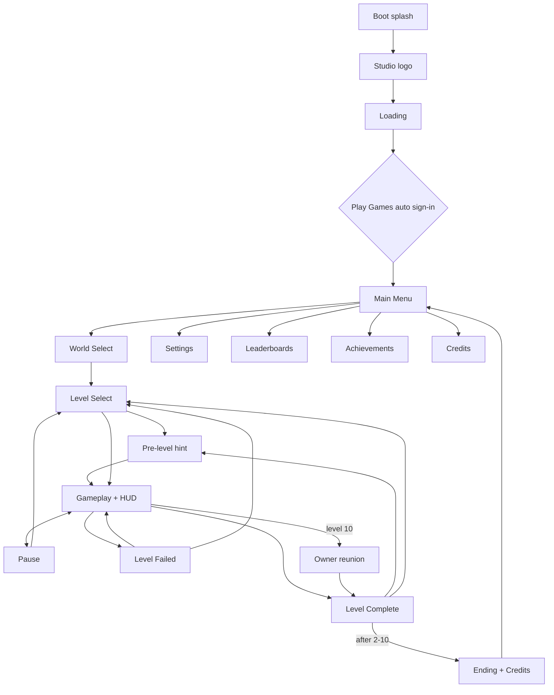

# wiwiwi — Production Plan (v1)

**Game:** wiwiwi · **Studio:** digicraft · **Engine:** Godot 4.7.2 (GDScript) · **Platform:** Android (Google Play)
**Package ID:** `com.digicraft.wiwiwi` — cannot change after the first upload.

> Facts marked **⚠ Verify** can change (store rules, plugin versions). Re-check before acting.
> Colors, fonts and art style are decided during development, not in this document.

## Contents
1. [Scope](#1-scope)
2. [Platform and Tech](#2-platform-and-tech)
3. [Gameplay Rules](#3-gameplay-rules)
4. [Screens and Flow](#4-screens-and-flow)
5. [Assets by Type](#5-assets-by-type)
6. [Tech Architecture](#6-tech-architecture)
7. [Google Services (no backend)](#7-google-services-no-backend)
8. [Android Export](#8-android-export)
9. [Testing](#9-testing)
10. [Release on Google Play](#10-release-on-google-play)
11. [Milestones M0–M5](#11-milestones-m0m5)
12. [Risks and Open Questions](#12-risks-and-open-questions)
13. [Future Updates (owner ideas)](#13-future-updates-owner-ideas)

---

## 1. Scope
- **v1:** 2 worlds × 10 levels. World 3 is a post-launch update.
- **World 1 — Meadow** (concept art): countryside, cottages, windmill. Teaches everything: run/jump, coins, milk, slimes, spikes, pits, moving platforms, checkpoints. Ends with the owner reunion.
- **World 2 — Sunset Town** (teased on the concept level map): rooftops at sunset, same rules plus one new enemy and one new hazard (e.g. crumbling tiles), harder levels; ends with the final "home" reunion.
- **Focus rule (29 Oct 2026):** build and polish **World 1 completely first**; World 2 starts only after World 1 is done properly.
- **Release plan (decided 11 Nov 2026, owners):** World 1 alone lasts only ~10–15 minutes, so the **next big public release comes when Worlds 1–5 (50 levels) are built**. Until then we work on content (worlds 2–5) and only test privately (dev phone, closed/internal testing). Live v0.1.0 stays as it is, apart from the small Play Games fix below if the owners agree. **Decided 11 Nov 2026: ship a quick 0.2.0 update now** (bundle built and checked the same day: version 0.2.0 / code 2, 32+64-bit, upload-key signed) (achievements + leaderboards code, already built) together with **publishing the Play Games project**, because on 0.1.0 every non-tester who taps 🏆/📊 sees "Couldn't sign in". Order inside the World 5 push: World 2 → 5 one at a time (art set + one new enemy/hazard + music + 10 levels + its achievements), a private test build after each world; ads/Premium (§13.2) decided when World 5 is close.
- **Carried over from the prototype:** gentle energy + milk, owner reunion at the end of each world, stompable slimes, moving platforms.
- **New:** 3 hearts per level, checkpoints, 3-star rating, level select, settings, Play Games.
- **Not in v1:** real-money purchases, ads, World 3, Hindi. (The coin Cat Shop was added in v1 on 1 Nov 2026.) **Long-term direction (11 Nov 2026):** 10 worlds, ads + a one-time "Remove ads" purchase — see [§13](#13-future-updates-owner-ideas).
- **Prototype** (`cozy-cat-platformer`) is reference only. v1 is built fresh in `C:\Godot\Projects\wiwiwi`.
- **Design references:** level select + star reveal (Angry Birds), one-thumb controls + coin loop (Hill Climb Racing), themed worlds + hidden collectibles + checkpoints (Lep's World). Structure only, nothing copied.

## 2. Platform and Tech
| Item | Decision |
|---|---|
| Store | Google Play — **AAB** for upload, **APK** for testing |
| Target API | 36 (Play requirement since 31 Aug 2026). Godot 4.7 default — confirmed in our first APK. |
| Min Android | 7.0 (API 24, Godot default) |
| Orientation | Landscape only (Sensor Landscape) |
| Resolution | Base 1920×1080, stretch `canvas_items`, aspect `expand` |
| Screen shapes | Wider phones show more world sideways; tablets show more above/below. All UI inside a **SafeArea** container (notches, edge-to-edge). **Tablets supported** (1 Nov 2026 check, see §11 M2): the Play listing allows large/xlarge screens; every screen checked at 4:3 and 16:10. |
| Renderer | Compatibility (widest low-end support), target 60 FPS |
| Input | Touch only: left, right, jump, pause |
| Text | All strings through `tr()` + CSV, ready for more languages |
| Effects / performance budget (decided 30 Oct 2026) | **Light effects only:** short one-shot 5-frame sprites (`Fx.spawn`, ~0.3 s, remove themselves). No glow/bloom, lights, shaders, large particle clouds or always-on ambient effects; little screen shake. Sound carries most of the "juice" (M2). Budget: 60 FPS on the Galaxy M11 (currently 58 with the background) |

## 3. Gameplay Rules
- **Controls feel:** acceleration/deceleration, variable jump height, coyote time, jump buffer. First M1 values (in `player.gd`, tunable in the Inspector): run 520 px/s reached in 0.08 s · full jump ≈ 300 px (0.42 s to apex, faster fall) · tap = short hop ≈ 140 px · coyote 0.12 s · buffer 0.12 s. Cat ≈ 150 px tall on screen.
- **Failing:** spikes, pits, enemy side-hits cost 1 heart → short hurt pose (knock-back hop, 0.7 s) → respawn at last checkpoint (blink + 1.2 s safe time, so one mistake never costs two hearts). Hazards only announce `Events.player_hurt`; the level applies the rule.
- **Water (30 Oct 2026):** pits hold water (`water.tscn`, set width/depth) about 100 px below the ground line; falling in = splash, she sinks out of sight (0.8 s), then the pit rule (lose a heart, back to the last flag). The plain fall line stays as a backup.
- **Spikes:** spike trap resting on the ground, `long` = 5 spikes (needs a real jump) or short = 3 spikes (easy hop).
- **Bouncy mushroom (added 31 Oct 2026, owner approved; World 1 element):** landing on the cap launches the cat — jump held = 2.2× a full jump (~660 px), not held = 1.6× (~480 px). Never hurts. Used to reach cliffs too high to jump and high coins/yarn; the yarn above a mushroom needs the held bounce (teaches it). `scenes/objects/mushroom.tscn`, art "Cute Red Mushroom Sprite Pair" (normal + squashed).
- **Slime (contact rules revised 1 Nov 2026 after owner playtest: jumping over slimes kept hurting):** the cat **in the air is never hurt** by a slime — feet above its middle squashes it and she bounces on (rising or falling), lower she just passes by; only walking into it on the ground hurts, with a narrower touch zone (70 px between centres). Before the fix 29 of 68 test jumps hurt; after: 0 (41 stomps, 23 clears) — `dev/m2_slime_jump_test.gd`. A cat in the hurt pose can't stomp or be hit. 0 hearts → Level Failed card → "Try again" restarts the level with fresh hearts, coins and flags.
- **Checkpoint:** paw flag; first touch raises it and moves the respawn point there. **Goal (changed 30 Oct 2026):** the girl waits at the end of **every** level (no cat bed). She waits with clasped hands and bounces when the cat comes near; reaching her, she kneels down (crouch → kneel reaching → arms wide), the cat walks in, and they hug (3-frame loop) while hearts float up, then the result card with stars. The world-end reunion (level 10) stays as a bigger story moment.
- **Energy:** drains slowly while moving (full tank = 35 s of moving, `Player.energy_seconds`); milk refills it to full. At 0 the cat runs at 65 % speed with slower legs and yawns (sleepy idle) when standing: never a fail (a tired cat still clears the widest gaps; tested). The cat only drinks when not already full, so a bowl is not wasted. Each level sets `start_energy` (1-1 starts at 40 % to teach milk). HUD: milk icon + bar, orange below 25 %.
- **Stars:** ★ reach the goal · ★★ collect ≥ 80% of coins · ★★★ find the hidden Golden Yarn.
- **Levels:** 1–3 teach, 4–7 combine, 8–9 challenge, 10 finale + owner reunion. 60–150 s each.
- **Fair-play rules (decided 30 Oct 2026, owner's request):** every obstacle must be passable the way a real player plays, so no hazard punishes a normal jump. After every gap: ≥ 450 px of safe ground before spikes and ≥ 300 px before a slime's patrol (a full-speed jump travels ~395 px). Before a take-off edge: no spikes within 300 px, no slime patrol within 200 px. Every main-path gap ≤ 260 px (a tired cat makes it); long spikes always have a floating step above as a safe route. **Between hazards (added 31 Oct 2026 after the owner kept getting hit by two slimes side by side on the 1-8 cliff):** two hazards on the same stretch of ground need ≥ 300 px of safe ground between their danger zones (slime patrol + body, spike width), so you can always land after jumping one. Checked automatically for every level in the catalog by `dev/m1_fairness_test.gd` — a new level isn't done until it passes.
- **Enemies:** World 1 slime; World 2 one new enemy + one new hazard.
- **Level data:** each level = a scene + a small `LevelData` resource (`data/levels/<id>.tres`: id, world, index, scene path, hint). `data/levels/level_catalog.tres` lists them in order; menus and unlocks read only from it. Regenerate with `tools/make_level_data.gd` after adding a level.
- **Level building = ground strips, not TileMap (decided 30 Oct 2026):** the World 1 art is a strip kit (left edge, repeating middle, right edge, thin floating piece) with no corners/slopes, so levels are made of resizable ground pieces. Pieces are `GroundBlock`s (`scenes/objects/ground_block.gd`, renamed from GreyboxBlock on 30 Oct 2026): set a size and the meadow art follows: repeating grass top, dirt fill below, grass corners and side outlines only where a side is open (a flush neighbour at the same height or higher hides it; a lower neighbour gets a corner and an outline down to its surface), seeded flowers/tufts on top, and the thin 3-piece art for one-way blocks. Kit built by `tools/art_pipeline/make_ground.py` at in-game size.
- **Save (built 30 Oct 2026, `autoload/save_manager.gd`):** local versioned `user://save.json`, no server. Per level: `done`, best `stars`, `best_coins`, `yarn` (found ever). Unlock rule: level 1 always open; every other level opens when the one before it is done. Saved automatically on level complete, keeping the best result (never goes down). Safe writes: temp file → swap, previous kept as `.bak` (used if the main file is damaged); `_migrate()` upgrades older versions. `user://settings.cfg` (separate): `music_on`, `sound_on`, `controls_size` (touch buttons read it). `wallet` + `cosmetics` exist but stay empty until a shop is decided (no migration needed then). Note: headless tests that finish a level also write the PC's dev save; the save test uses its own files.

## 4. Screens and Flow

| Screen | Owner scene |
|---|---|
| Logo, Loading | `ui/screens/logo_screen.tscn`, `loading_screen.tscn` |
| Main Menu | `ui/screens/main_menu.tscn` |
| World Select, Level Select | `ui/screens/world_select.tscn`, `level_select.tscn` |
| Pre-level hint | `ui/screens/level_intro.tscn` |
| HUD (hearts, coins, yarn, energy, pause, touch controls) | `ui/hud/hud.tscn` |
| Pause, Level Complete, Level Failed | `ui/screens/pause_menu.tscn`, `level_complete.tscn`, `level_failed.tscn` |
| Settings v1: music on/off, sounds on/off, touch-button size S/M/L (later: Play Games sign-in, Credits, reset progress) | popup in `ui/hud/game_menu.gd` (`show_settings`) |
| Credits | `ui/screens/credits.tscn` |
| Owner reunion | `scenes/objects/owner/owner.tscn` |

**Home page v3 + Cat Shop (decided 1 Nov 2026, co-founder: "the home page has very few buttons").** Built in this order, one step at a time:
1. ✅ **Coin purse + top bar.** Every coin picked up in a *finished* level goes into a saved purse (`wallet.coins` in save.json; replays earn again; coins from an unfinished run are not kept). Home page top-right shows three wooden pills: ⭐ stars won / 30, 🧶 Golden Yarns / 10, 🪙 purse (`ui/components/stat_pill.gd`, `SaveManager.total_stars/total_yarns/purse/add_coins/spend_coins`). Test: `dev/m2_purse_test.gd`.
2. ✅ **Leaderboard + Achievements** round buttons (bottom row: Achievements 🏆, Settings ⚙, Play, Leaderboards; the Cat Shop 🐾 takes the last spot on the right). `PlayServices.show_leaderboards/show_achievements` sign in first if needed (a tap during the launch check waits for it; a silent "no" shows Google's sign-in once), otherwise a kind note pops up (`GameMenu.show_notice`): "not available" on PC, "couldn't sign in" on a phone. They open Google's own screens, which stay empty until the leaderboard and achievements are created in Play Console (after the app-signing SHA-1). Test: `dev/m2_play_games_test.gd`.
3. ✅ **Cat Shop** (🐾 button, last in the bottom row), built 1 Nov 2026. A popup shows one big cat at a time with ◀ ▶ arrows, the coin purse, and one button: *Chosen* (grey) / *Choose* / *🪙 price* (buy = pay + choose, confetti + happy meow) / *Need N* (greyed). 6 cats, recolours of the kitten by `scenes/actors/player/cat_recolor.gdshader` (only the orange patches are repainted, keeping their shading; white fur, outlines, eyes, collar and bell stay): **Ginger** free, **Snowy** 150, **Cocoa** 250, **Misty** (blue-grey) 400, **Tuxedo** 600, **Bubblegum** (pink) 800 — list in `scenes/actors/player/cat_skins.gd` (`CatSkins`). The chosen cat is worn on the home cushion, in popups, on the map, in levels and in the girl's hug (shader limited to the kitten's area of the hug art, `HUG_REGION`, so her hair is untouched). Save: `cosmetics` = cats bought, `cat` = chosen (old saves get ginger). Test: `dev/m2_shop_test.gd`. New breeds later: own SpriteFrames + home frames, added to `CatSkins.ALL`.
4. ✅ **Pet the kitten**: an invisible touch area over her on the home page (not a Button, so no click sound). A pat closes her eyes (blink frame), starts the purr (50 % a happy meow), she wiggles and 2 hearts float up; more pats keep her happy; 1.6 s after the last pat she opens her eyes and the purr fades. Leaving the page stops the purr. Test: `dev/m2_pet_test.gd`.

Home page v3 done (1 Nov 2026): top bar ⭐ 🧶 🪙, bottom row 🏆 ⚙ ▶ 📊 🐾, pettable kitten in her chosen colour.
Later: daily gift box (only once coins have a use, i.e. after the shop).

**Android Back button (built 31 Oct 2026):** level → pause; pause → resume; Settings opened from pause → back to pause; Level complete / Try again → map; map → home; home → closes Settings if open, otherwise "Leave wiwiwi?" (Stay / Leave). No Quit button on Android; `quit_on_go_back=false` so nothing closes by surprise. Checked by `dev/m2_back_test.gd` (9 checks).

## 5. Assets by Type
Sources: **Self** = we draw/record · **CC0** = Kenney packs as a base, restyled · **OFL** = open fonts · **AI** = ElevenLabs (⚠ commercial rights depend on plan).
P0 = needed for the vertical slice (M2) · P1 = needed for launch · P2 = nice to have.

| Type | Items | Source | Priority |
|---|---|---|---|
| Cat animations | idle, run, jump, fall, land, hurt (P0); collect, sleepy, win (P1) — sprite sheets for AnimatedSprite2D | Self | P0/P1 |
| Owner | idle, wave, hug (cutscene via AnimationPlayer) | Self | P1 |
| Enemies | W1 enemy (P0), W2 enemy (P1) | Self | P0/P1 |
| Ground kit | 1 per world: left edge, repeating middle, right edge, floating piece (ground strips, see §3) | Self (ChatGPT) | P0/P1 |
| Backgrounds | 3–4 parallax layers per world (Parallax2D) | CC0 base + Self | P0/P1 |
| Objects | coin, golden yarn, milk bowl, checkpoint flag, goal girl, spikes, platforms (one-way, moving, crumbling), decorations | Self / CC0 | P0/P1 |
| FX | sparkle, dust, confetti (CPUParticles2D textures) | Self | P0/P1 |
| UI | 9-slice buttons and panels, icon set, star icons, touch-control art, world cards | Self / CC0 | P0 |
| Fonts | 1 display + 1 UI font, open license, embedded with license file | OFL | P0 |
| Music | menu theme, 1 loop per world | AI / composer | P0/P1 |
| SFX | player, world, UI sounds | AI / CC0 / generated | P0 |
| Store assets | 512 icon, adaptive icon layers, feature graphic, screenshots, boot splash | Self | P1 |

**Folders:** `assets/art/{characters,enemies,objects,tiles,backgrounds,ui,fx}`, `assets/audio/{music,sfx}`, `assets/fonts` (+ `licenses/`), `data/`, `scenes/`, `ui/`, `autoload/`, `localization/`.
**Naming:** `snake_case` files, `PascalCase` nodes, prefixes `bg_`, `tiles_`, `fx_`, `ui_`, `mus_`, `sfx_`. No spaces or dates in names.

### 5.1 Concept art (`assets/raw_assets_idea/`, added 29 Oct 2026)
26 concept images define the **art direction**: chibi kawaii, hand-drawn look, warm brown outlines, soft countryside (cottage, windmill, meadow). They are the **reference and source** for game art, never used directly in the game.
- **Folder rules:** stays untouched as the master copy. Excluded from Godot (`.gdignore`, so ~40 MB never ships) and from Git (`.gitignore`; kept locally only, by decision 29 Oct 2026).
- **Source and rights:** generated with **ChatGPT** from our own prompts; per OpenAI's terms the output belongs to us (⚠ re-check their terms before launch and keep a note). New/missing art is made the same way so the style stays consistent.
- **Decisions:** the owner girl wears the **red pinafore dress** (pose sheet); the denim outfit in the banner is reference only. Settings screen: **toggles only** (music, sound) — no volume sliders, no vibration for now.
- **Pipeline (scripted, repeatable):** remove the white background → slice each sheet into single pieces → align animation frames to one baseline and cell size → export clean PNGs to `assets/art/...` → build SpriteFrames / 9-slice styles / atlases. Re-running the script after an art change updates the game.

| Concept sheet | Becomes in game | Work needed |
|---|---|---|
| Kitten animation + pose sheets | Cat: idle (3), walk (6), jump (2), hurt, cheer (2) frames; expressions for UI | Background removal, frame alignment; missing: fall, land, sleepy |
| Girl hugging animation sheet | Owner at the goal: wait (clasped hands), crouch, kneel reaching, kneel arms wide | Cut (`assets/art/characters/girl/`), aligned on her front shoe so she stays planted |
| Three-frame cat hug sheet | 3 hug frames (girl + kitten) | Cut, scaled to the kneel sheet's size (509/664) and auto-aligned on the dress/legs so the loop doesn't jiggle. (Older girl pose sheet + first hug sheet: replaced, not used) |
| Slime sheet | Slime walk (3) + squish; orange variant = World 2 or harder slime | Cut + align |
| Platformer asset sheet | Spikes, **checkpoint flag** (off/on), **cat bed = level goal**, floating island, signpost | Cut |
| Effects sheet | Dust, coin sparkle, star burst, heart break, checkpoint activation, confetti (5 frames each) | Cut into one-shot animations |
| Icon sheets | Coin spin (5 frames), milk bowl full/empty, heart full/empty, star full/empty, all menu icons | Cut into a UI atlas |
| UI asset sheet + control buttons | Pill buttons (4 colours × 3 states), round buttons, cream panel, wooden title sign, ribbon; touch controls ◀ ▶ 🐾 (normal/pressed) | Cut + 9-slice margins; text is added in Godot (translatable) |
| Ground sheets (30 Oct): "Seamless Cartoon Grass and Dirt Tile", "Seamless Cartoon Cobblestone Dirt Texture", "Cartoon Grassy Platform End Tiles", "Cartoon Grassy Platform Tile Set", "Cute Cartoon Nature Game Assets" | World 1 ground: repeating top, dirt fill, end caps, thin one-way platform, decorations | Done: `make_ground.py`. (Older "Meadow tileset" grid has baked-in glow: not used) |
| Props sheets | Decorations: bushes, mushrooms, rocks, fences, logs, stumps, flowers | Cut |
| Countryside panorama | World 1 far background | Single flat layer, too small for scrolling → needs separate wide parallax layers |
| Screen mockups (loading, menu, level map, gameplay, pause, try again, level complete, settings) | **Layout reference** for each screen | Rebuilt in Godot from the cut pieces |
| App icons + banner | Play Store icon, adaptive icon, feature graphic (banner fits 1024×500) | Adaptive icon needs separate foreground/background layers |

**Still missing (create with the same tool/style):** nothing for World 1 gameplay (backgrounds done 30 Oct 2026) · HUD frames (hearts bar, coin counter, energy bar) · level-map node set (number, stars, lock) · all World 2 art (sunset town tiles, background, enemy, crumbling tile).

## 6. Tech Architecture
| Autoload | Job |
|---|---|
| `Events` | Global signal bus (coins, hearts, level results, achievement progress) |
| `GameState` | Current level, running attempt, level catalog, unlocks |
| `SaveManager` | Local save + settings, versions, migrations, cloud merge |
| `AudioManager` | Music crossfade, SFX pool, buses (Master → Music / SFX / UI) |
| `SceneTransition` | Fades between scenes, async loading |
| `PlayServices` | Wrapper for Play Games; does nothing on PC or when signed out |
| `Economy` *(future slot)* | Wallet + coin shop; hidden behind a feature flag in v1 |

- **Signals:** objects talk to parents locally; anything global goes through `Events`. Achievements are data-driven and tracked by one listener.
- **Levels:** `scenes/levels/level_base.tscn` + `level.gd` (Terrain, Objects, PlayerSpawn, Player + Camera, HUD with touch controls). The camera limits fit the terrain automatically; falling below it is a pit. Each level **inherits** the base and only adds terrain and objects (e.g. `scenes/levels/w1/level_w1_01.tscn`).
- **Performance:** texture atlases; lossless for UI/characters, VRAM-compressed (ETC2/ASTC) for large backgrounds; CPUParticles2D only, capped; enemies off-screen are disabled; one world's assets loaded at a time; AAB target < 80 MB.

## 7. Google Services (no backend)
**We run no backend of our own:** no servers, no database, no user accounts. Progress lives on the device. Everything online uses Google Play's prebuilt services.

### 7.1 Google Play Games Services — v1
- **What it's for:** sign-in, achievements, leaderboards, cloud save. **Not for payments.**
- **Sign-in:** automatic at launch (PGS v2); a manual "Sign in" button only if it fails or the player declines. The game works fully when signed out.
- **v1:** sign-in, ~12 achievements, 2 leaderboards.
- **✅ Sign-in works (10 Nov 2026)** after the phone's Play Games account was added to Play Games Services → Testers.
- **Approved list (10 Nov 2026, owners):** leaderboards **Most stars** (total stars, larger is better) and **Coin collector** (all coins ever picked up, needs a lifetime counter separate from the purse). Achievements, all revealed (points): First Steps — finish a level (25); Halfway Home — finish 1-5 (50); Home Again — finish World 1 (100); Star Gazer — 15 stars (50); Perfect Meadow — 30 stars (150); Shiny Find — first Golden Yarn (25); Yarn Master — all 10 yarns (100); Slime Squisher — 25 slimes, incremental 25 (50); Not a Scratch — finish a level without losing a heart (50); Piggy Bank — 500 coins total, incremental 500 (75); New Look — buy a cat (25); Cat Collector — own all 6 cats (150). Total 850 (Google allows 2000). Order: owners create them in Play Console and send the IDs → wire unlocks/scores in code (PlayServices) → test on the dev phone → publish the Play Games project. Published achievements can't be deleted, only hidden. Icons: made by the owners (ChatGPT, one shared style prompt), uploaded with each entry.
- **✅ Created in Play Console and wired into the game (10 Nov 2026).** IDs live in `autoload/play_services.gd` (`LEADERBOARDS`, `ACHIEVEMENTS`; Google numbers them CgkI8qjHoLMHEAIQAg … QDw in creation order). How it works: `achievement_targets()` / `leaderboard_scores()` work everything out **from the save**, and `sync()` sends only what changed — on sign-in and on every `SaveManager.progress_changed` — so progress made signed out or offline is never lost. New save `stats`: `coins_ever` (coins from finished levels; the purse can go down, this can't; old saves start it from the purse), `slimes` (squished), `flawless` (a level finished with all 3 hearts). Test: `dev/m2_achievements_test.gd` (fake clients in `dev/fake_play_games.gd`). Points used 850 / 2000 (Google's limit is 2000, 5–200 each): 1150 left for future worlds. Adding a world later = create new entries, add IDs + rules here, publish again. ✅ **Play Games project published** (11 Nov 2026, owners) — sign-in, achievements and leaderboards open to every player. ✅ **0.2.0 (code 2) submitted for Production review** the same day (full rollout). ⬜ After approval: update from the Play Store and check scores/achievements on a phone.
- **Phones (10 Nov 2026):** the developer's **new phone = development phone** (debug APKs over wireless debugging; uninstall any Play Store copy first, different signing key); the old Galaxy M11 keeps the Play Store version. **v1.1:** cloud save (Saved Games/snapshots) using our existing save file.
- **Plugin:** `godot-play-game-services` v3.4.0 (github.com/godot-sdk-integrations, MIT). **Verified on Godot 4.7.2 on a real phone (M0).** Needs a Gradle build and a Play Games game ID in the export preset.
- **Setup:** create the app in Play Console → upload a build to internal testing → create the Play Games project → add credentials (SHA-1 of signing keys) → create achievements/leaderboards → add testers → put the game ID in export settings → publish with the release.
- **Status:** Play Games project created, linked to Google Cloud project **"wiwiwi"**, game ID **`254276654194`** (in both export presets). Credentials, testers and the real sign-in test happen in **M2**, after the first Internal testing upload.
- **Signing fingerprints (SHA-1) for Play Games credentials** (received 1 Nov 2026): **app signing key** (Play re-signs every Play Store install with it) `B3:1F:21:A2:E3:54:4C:B5:7A:8F:D5:98:55:C0:25:97:94:16:F3:B9`; **upload key** (our `wiwiwi-upload.keystore`) `3A:5B:4F:6F:9C:87:32:A5:99:D1:B2:3A:B7:A0:06:88:2B:F6:E4:49`; **debug key** (test APKs) `76:EA:46:81:AC:A0:5C:A5:6A:D6:A1:7E:D3:DA:E8:64:8F:E3:12:08`. One Android OAuth credential each for app-signing and debug (upload key optional). Public values, safe to keep here.
- **Credentials progress (1 Nov 2026):** the developer got **Editor** on Google Cloud project `wiwiwi-513022` (granted by the co-founder) plus Play Games edit rights. ✅ Android credential **"wiwiwi"** (anti-piracy **Off** so PC-installed test builds can sign in; consider On before public launch) → OAuth client `254276654194-d6oksnsr9mq2s2vhd198hcit2levn6fk.apps.googleusercontent.com`, app-signing SHA-1, saved. Testers list already filled. ✅ second Android credential (debug SHA-1, for PC-installed test APKs) → OAuth client **"wiwiwi Test Build"** `254276654194-3ljgfgfpe8ugnlta34gvg5m4j7o8meor.apps.googleusercontent.com`. ⬜ achievements + leaderboards.
- **Sign-in investigation (1–9 Nov 2026):** Play Store install (app-signing key) and test APK both failed with *"APP ID IS NOT CORRECTLY CONFIGURED… Application 254276654194 is not associated with package com.digicraft.wiwiwi"* (log: OAuth consent succeeded, then LOAD_GAME failed, code 10002), still failing after a week. Our side checked: the build's `game_services_project_id` is exactly `254276654194` (digits only) and the package matches. Cause per Google's troubleshooting: while the Play Games project is **unpublished (Draft)**, only accounts on **Play Games Services → Testers** can sign in (this list is separate from the closed-test Google Group), and the account that created the game must be on it too. 9 Nov: owner account added to the testers list (3 testers); the developer's phone account still to be confirmed/added. **Then publish the Play Games project** (Review and publish; needs Properties: description, icon, feature graphic), because the app itself is already live.
- ⚠ **The app is live in Production** (Play Console 9 Nov: production release 1 (0.1.0) from 1 Nov 21:50, 100 % roll-out, 5 installs), not only closed testing. Until the Play Games project is published, every non-tester player sees "Couldn't sign in" on 🏆 / 📊 (the game itself works). Also pending for the account owner: **"Declare your trader status"** banner in Play Console. Google says new clients can take minutes to hours to start working.

### 7.2 Google Play Billing — future slot (not in v1)
- **What it's for:** real-money purchases (e.g. cosmetic packs) and subscriptions. **Not used in v1.** First planned product (11 Nov 2026): **"Premium — remove ads", one-time lifetime purchase (~₹250, ⚠ confirm price)**, see §13.
- **Kept ready by:** the `Economy` autoload and save fields. A coin shop using only earned coins needs no Billing at all.
- **When added:** Google Play Billing Library via a Godot plugin (⚠ choose and verify the maintained plugin at that time); purchases are verified by Google Play, still no backend of our own. Adds Play Console products and a Data safety update.

## 8. Android Export
- [x] Godot 4.7.2 export templates · JDK 17 · Android SDK (platform-tools, build-tools 35.0.1, platforms 35 + 36, command-line tools, CMake 3.10.2, NDK r28b)
- [x] Export preset: package, version code/name, arm64 + armv7, immersive, landscape
- [x] Gradle build on (needed for plugins and AAB)
- [x] Release (upload) keystore `C:\Godot\Keys\wiwiwi-upload.keystore`, alias `upload`, valid to 2054; password only in Godot's ignored `export_credentials.cfg` (back up the file in 2 places)
- Certificate SHA-1 (public, for Play Games credentials): upload `3A:5B:4F:6F:9C:87:32:A5:99:D1:B2:3A:B7:A0:06:88:2B:F6:E4:49` · Godot debug `76:EA:46:81:AC:A0:5C:A5:6A:D6:A1:7E:D3:DA:E8:64:8F:E3:12:08` · app signing key: from Play Console after the first upload
- [x] Signed release AAB builds (`Android Release (AAB)` preset, ~53 MB)
- [ ] Play App Signing enrolled on first upload
- [ ] Debug build adds x86_64 only for the emulator; release stays ARM

## 9. Testing
- **Devices:** **Samsung Galaxy M11** (Android 12, 720×1560, punch-hole camera, Adreno 506) = our real low-end test phone, connected by wireless debugging. Android Emulator for other shapes (20:9, tablet). Play Console **pre-launch report** and **closed-test testers' phones** before release.
- **Emulator limits:** FPS is not realistic (uses the laptop GPU), and the mouse is one finger only. Performance and multi-touch are checked on the M11.
- **Each milestone:** feel test with 3–5 players, level checks (completable, no soft-locks), save tests (kill app mid-save, migrations), interruption tests (home button, screen off → auto-pause), Play Games signed in/out/offline, 10-min performance run on the slowest device.
- **Before release:** Play Console pre-launch report.

## 10. Release on Google Play
- **Account:** existing developer account **"DigiCraft Innovation"** (also publishes StoreMitr, `com.digicraft.storemitr`), owned by the co-founder. **The developer has Play Console access (granted 29 Oct 2026)** and uploads builds directly. The keystore and its password stay with the developer.
- **Official website:** **https://wiwiwi.digicraft.one/** — pages: `/privacy` (privacy policy, used in Play Console), `/terms`, `/support`, `/delete-data`. Any change to how the game handles data (cloud save, purchases, new SDKs) must be reflected in `/privacy` and the Data safety form in the same release.
- [x] App **wiwiwi** created in Play Console (Game, Free)
- [x] Privacy policy URL set: https://wiwiwi.digicraft.one/privacy (required even with no data collected)
- **Decisions:** App access = **"No restricted access"** (sign-in optional, no purchases; revisit if paid content is added). Store category = **Adventure** (recommended), with tags such as Platformer, Casual, Cute, Single player, Offline.
- [x] **First release submitted 1 Nov 2026, in review:** the owners chose **Closed testing – Alpha** (not internal) with build 0.1.0 (1) = `builds/wiwiwi-release.aab` (home page v3 + Cat Shop), country **India**, testers via the Google Group **digicraft-tester@googlegroups.com** (testers join the group, then opt in with the test link). Store listing (en-US), content rating questionnaire and target audience were submitted with it. ⚠ Play Console shows target age **18 and older** (plan said 13+); 18+ is the strictest choice and fine for now — revisit before public launch if younger players are wanted. Next: when review passes, testers install from the Play Store (uninstall the debug build first); the owner sends the **app-signing SHA-1** (App integrity → App signing; available already after the upload) for Play Games credentials.
- [~] Data safety form (check it was submitted with the first release; we collect nothing ourselves; include what the Play Games SDK does)
- [x] Content rating, target audience (18+ for now; ⚠ under-13 → Families policy), ads: none — submitted 1 Nov 2026
- [x] Store listing (en-US): texts, icon, feature graphic, screenshots — submitted 1 Nov 2026
- [ ] **Closed test: ≥ 12 testers opted in for 14 continuous days** — only if the account is a *personal* account created after Nov 2023 (⚠ check account type in Settings → Developer account; organization accounts are exempt), then apply for production access
- [ ] Staged rollout 20% → 100%; watch crashes/ANRs for 2 weeks

## 11. Milestones M0–M5
Estimates are combined focused hours. At **[X] h/week**: weeks = hours ÷ X (≈ 22 weeks at 20 h/week).

### M0 — Setup and export test (≈ 30 h) — ✅ closed 29 Oct 2026
Decision: build the game first; store upload and Play Games sign-in test move to M2 (when there is something to test).
- [x] Fresh project + local Git repo
- [x] GitHub (30 Oct 2026): private repo `roshnikumari-21/wiwiwi` (the renamed prototype repo). `main` = this game; the old prototype is kept on the `prototype` branch
- [x] Project settings, folders, empty autoloads, translation CSV
- [x] Android toolchain + debug APK (target SDK 36, landscape, no permissions)
- [x] SafeArea container + device-check screen
- [x] APK runs on a real phone (Galaxy M11): 60 FPS, landscape lock, punch-hole detected and avoided, fade works
- [x] Multi-touch check on the M11 (3 fingers detected)
- [x] Game name: **wiwiwi**
- [x] Studio name **digicraft** → package ID `com.digicraft.wiwiwi` (not used on Google Play as of 29 Oct 2026)
- [x] Release keystore (see §8) · Play Console app created in the DigiCraft Innovation account
- [x] Official website live: https://wiwiwi.digicraft.one/ (privacy, terms, support, data deletion)
- [x] Gradle build + Play Games plugin v3.4.0 (MIT) loads on the phone with Godot 4.7.2; `PlayServices` wrapper reports signed_out gracefully
- [x] Play Games project created (Cloud project "wiwiwi"); game ID `254276654194` in both export presets
- [x] First AAB export (real package ID, real game ID, signed with the upload key)
- [x] Project folder renamed to `C:\Godot\Projects\wiwiwi`
- Carried forward: ElevenLabs commercial rights check (before audio goes in, M2)
- Build note (31 Oct 2026): a Gradle export once crashed ("daemon disappeared", likely low memory on the PC); re-running worked. If it repeats: close other apps, or lower Gradle memory in `android/build/gradle.properties`.

### M1 — Prototype, greybox (≈ 70 h)
- [x] Concept art: `.gdignore` on `raw_assets_idea`; asset pipeline (`tools/art_pipeline/`: `cut_cat.py`, `cut_pieces.py`); 20 aligned cat frames → 8 animations (idle, walk, jump, fall, land, hurt, cheer, sleepy) + touch-button art
- [x] Player controller v2 + camera (look-ahead, vertical drag), greybox blocks, test room `dev/m1_movement_test.tscn` (current main scene); automated feel checks pass
- [x] Play-tested on the Galaxy M11 (30 Oct 2026): movement feel approved as is. Idle reworked: still pose from the new idle sheet + a blink made by pasting only the closed eyes onto the same frame (zero wobble), blinking every few seconds with an occasional double blink; breathing is a 1.2 % scale in code. Rule: never loop separately drawn AI frames for "still" poses. Air poses (30 Oct): a jump keeps the leap pose for the whole arc; legs fold only on touchdown ("land"); ledge drops without a jump use one steady "fall" frame (the folded L1 frame was removed)
- [x] `level_base` + `level.gd` (auto camera limits, pit respawn), `LevelData` + `LevelCatalog` + `tools/make_level_data.gd`, `GameState` (catalog, current level, `start_level`), greybox level 1-1 (main scene); tested on PC + phone
- [x] Level-end hug: girl at the goal `goal_girl.tscn` (waits → bounces → kneels down in 3 frames → cat walks in → 3-frame hug loop + hearts → result card); cat bed removed; `Player.walk_to()` for cutscenes; pipeline clears trapped white gaps (`hole_min_area`)
- [x] Hearts, checkpoints, respawn, coins, golden yarn, goal, stars: object scenes in `scenes/objects/` (coin, golden_yarn, checkpoint, goal_girl) using cut concept art; `Events` + `GameState` run the attempt; placeholder HUD (`ui/hud/hud.tscn`: hearts, coins x/y, yarn) + win/fail card; level 1-1 has 16 coins, 1 yarn, 1 flag, the girl; `dev/m1_rules_test.gd` passes (22 checks); runs on the M11
- [x] Energy + milk: `Player` energy (drain, tired speed, sleepy idle), `milk_bowl.tscn` (full → empty), HUD energy bar, 1 bowl in level 1-1; `dev/m1_energy_test.gd` passes (14 checks)
- [x] Spikes + slime: shared hurt rule (`Events.player_hurt` → level), `spikes.tscn`, `slime.tscn` (green row of the slime sheet; orange kept for later), 1 spike patch + 1 slime in level 1-1; `dev/m1_hazards_test.gd` passes (11 checks)
- [x] Moving + one-way platforms: `moving_platform.tscn` (grass-topped plank art, glides between two points with end pauses, carries the cat, one-way); one-way floating steps were already `GreyboxBlock.one_way`. Level 1-1 now has a 500 px pit before the girl that you cross on the plank; the girl's reach zone starts at the ground edge and the cat stops as soon as she reaches her; `dev/m1_platform_test.gd` passes
- [x] Touch controls in SafeArea (concept-art buttons, opacity/size ready for Settings)
- [x] World 1 ground art (30 Oct 2026): 5 new sheets (seamless grass+dirt top, seamless dirt, end caps, thin platform set, decorations) → `assets/art/tiles/meadow/`; caps scaled to the top tile's size and faded into it; all blocks in level 1-1 use it; tests pass
- [x] World 1 parallax background (30 Oct 2026): sky+hills (far), countryside panorama (mid, mirrored so it repeats; its grass continues below, darkening, so pits never show empty sky). The bushes strip was tried as a near layer and dropped at the owner's request (looked messy); M11: 58 FPS; `tools/art_pipeline/make_background.py`, `scenes/levels/backgrounds/meadow_background.tscn` in `level_base` (every level gets it). Debug builds show an FPS counter (top-right) for the performance check
- [x] Water in pits (surface strip + underwater body, splash, sink) and new spike-trap art (short/long) replacing the old spikes; level 1-1 has water in all 3 pits; hazard test now 15 checks
- [x] Light effects (30 Oct 2026): `scenes/fx/fx.gd` (`Fx.spawn`), cut by grid from the effects sheet with `tools/art_pipeline/make_fx.py`: coin flip + sparkles, milk energy sparkle, checkpoint star burst, landing dust (big falls), heart break when hurt, confetti at the hug; `dev/m1_fx_test.gd` checks they appear and clean themselves up
- [x] 3 levels (30 Oct 2026): 1-1 "Meadow Morning" (basics, 16 coins), 1-2 "Slime Meadow" (4 slimes, milk at half energy, sideways plank over a pond, floating steps to the yarn; 19 coins), 1-3 "Over the Water" (lift plank up a cliff, long spikes with a floating step above each, 4 ponds, 5 slimes, 2 milk; 21 coins). Every main-path gap ≤ 260 px so a tired cat always gets through. Win card has "Next level" (1-1 → 1-2 → 1-3); catalog via `tools/make_level_data.gd`; `dev/m1_levels_test.gd` checks each level loads/finishes and the plank, lift and spike-step moves
- [x] Playtest round 1 (30 Oct 2026, owner on the M11): jump button moved 160 px in from the right edge; spikes landed on after the last pond of 1-2 → fair-play rules added and enforced by a test; 1-1 spikes/slime nudged, 1-2 end spikes + 4th slime moved, 1-3 re-laid out with more ground around spikes and the lift (now ~8,200 px)
- [x] Screen shapes (30 Oct 2026): checked at 16:9, 20:9 (M11-like) and 4:3/5:4 tablet by windowed runs; fix: background layers are now placed from the screen centre (like the camera) and the far layer's top fades into the sky, so tablets no longer show a line in the sky or a tall dark band. Real-device check on a tablet/emulator still useful in M4 (safe areas, touch)
- [x] Tablet check (1 Nov 2026, owner asked "is it suitable for tablets?"): export allows small→xlarge screens; home, settings, map, a level with HUD + touch buttons, pause and level-complete screenshotted at 4:3 (1440×1080) and 16:10 (1280×800). All fine except the **level map**, which covered the screen and so cut off level 1 and the girl on squarer screens. Fix: the map shrinks until the whole path (`PATH_WIDTH` 1640 map px) fits, a dimmed copy fills the strips above/below, and the picture's top/bottom edges fade into it (`ui/screens/map_edge_fade.gdshader`). Phones (16:9, 20:9) unchanged. Touch buttons stay in the corners at the same size; bigger tablets can pick L in Settings. Still to do in M4: one real tablet or emulator run.
- [x] Performance: 58 FPS on the M11 with the background (debug FPS counter)
- **M1 closed 30 Oct 2026.** Further playtest rounds continue during M2/M3.

### M2 — Vertical slice (≈ 110 h)
Order agreed 30 Oct 2026: save system → home page → level map → pause / level complete / try again screens → settings → Android Back button → font. Art: start from the concept screens (Cottage Game Menu, Meadow Level Map, Level Buttons and Stars, Pause Menu, Level Complete, Try Again, Settings Menu); ask the owner for missing pieces (likely: a map background wide enough to scroll, level buttons without baked-in numbers) once cut.
- [x] Home page (31 Oct 2026): `ui/screens/main_menu.tscn` is now the start scene: drifting meadow background (`parallax_background.gd` got a `drift` option), the kitten on the grass, wooden-sign title (stand-in), big pulsing yellow Play button → first level not finished (`GameState.next_level_to_play()`; the level map takes this over next). Settings/trophy buttons left out until those screens exist (no dead buttons). UI kit cut by `tools/art_pipeline/make_ui.py` → `assets/art/ui/menu/` (pills ×4 colours ×3 states, round buttons, 18 icons, leafy panel, wooden sign, ribbon). `dev/m2_menu_test.gd`
- [x] Level map (31 Oct 2026): `ui/screens/level_map.tscn`: home Play → map → tap a level. 10 spots along the meadow path; open levels show their number + best stars (from the save), locked/unbuilt spots show a lock and wobble when tapped; the kitten waits on the next level to play (pulsing spot). Home button top-left. Picture always covers the screen (wide phones crop top/bottom slightly). Win/fail card got a **Map** button. Background = owner's clean map painting (`tools/art_pipeline/make_map.py`). Level button + star art cut from "Cartoon Level Buttons and Stars" (`make_ui.py`, grey checkerboard removed). `dev/m2_menu_test.gd` now covers home → map → level → Map (11 checks)
- [x] Pause + result popups (31 Oct 2026), matching the Pause / Level Complete / Try Again concepts, built from the cut UI kit (no new art needed): `ui/hud/game_menu.gd` (leafy cream panel, wooden title sign, the game's kitten cheering / sleepy) + `ui/components/pill_button.gd` (pill art stretches only in the middle, optional icon). Pause button top-right in the HUD → Paused (Resume, Restart, Map, Home); the game also **pauses itself when the app loses focus** (call, home button), and buttons held at that moment are released. Level complete! (stars pop in one by one, coins x/y, Golden Yarn found or not; Map / Replay / Next). Try again? (Retry / Map). Old plain card removed. `dev/m2_popups_test.gd` (10 checks). Settings button joins the pause menu when Settings exists.
- [x] Fix: `make_ui.py` kept only the biggest piece of every icon, which dropped one pause bar and the sound waves; that clean-up now applies only to the level buttons.
- [x] Home page v2 (31 Oct 2026), matching the "Cottage Game Menu" concept, from the owner's split art (`tools/art_pipeline/make_home.py` → `assets/art/ui/home/`): porch background ("Sunny Countryside Veranda Retreat", 2:1 so wide phones need little cropping), paw cushion, the kitten lying on it (breathing + blink every few seconds; the blink frame = only the eyes/nose/mouth of the eyes-closed drawing pasted onto the open one, so she doesn't twitch), sign-only logo (sways), floral yellow Play button (normal/pressed) → level map. Everything sits on one "stage" scaled to cover the screen, so the button never covers the kitten on any shape (checked 16:9, 20:9, 4:3). Round wooden button art (normal/pressed) is ready for Settings / leaderboard / achievements, added when those screens exist.
- **Decided 31 Oct 2026 (girl on screens):** the home page shows the kitten alone (the hug stays the level-end reward; the kitten waiting alone hints at the story). The girl waits at the end of the level-map path (`girl_wait`, just past spot 10). (A "together on the porch after World 1" reward was tried and dropped by the owner on 31 Oct 2026.) The hug image is also the best choice for Play Store graphics.
- [x] Owner art received 31 Oct 2026: clean map "Whimsical Countryside Adventure Map" (path has round pads; `SPOTS` set on them; inpainting stand-in retired) and logo "Kawaii Cat Wiwiwi Garden Logo" (already transparent; trimmed to `assets/art/ui/menu/logo.png`, sways gently on the home page, replaces the wooden-sign title). Logo also usable later for the loading screen and store icon/feature graphic. (The home page now uses the sign-only logo, so the cat logo is reserved for loading screen + store.)
- [x] SaveManager v1 (30 Oct 2026): progress + unlocks + best results + settings, safe writes, backup, migration; `dev/m2_save_test.gd` (10 checks)
- [x] Art direction set by the concept art in `assets/raw_assets_idea/` (§5.1)
- [x] Settings (31 Oct 2026): popup in the same style as the other popups (`GameMenu.show_settings`), opened from a round gear button on the home page and from a Settings button in the pause menu (Back returns to the pause menu; the game stays paused). Music on/off, Sounds on/off (sounds = SFX + UI buses), touch buttons S / M / L (0.8 / 1.0 / 1.2, applied immediately). Saved at once in `user://settings.cfg`. `AudioManager` mutes the buses from the settings, so music/SFX added later obey automatically. Left out on purpose (decided earlier): volume sliders, vibration, button opacity. Play Games sign-in and Credits join the settings screen when they exist. `dev/m2_settings_test.gd` (12 checks)
- [x] Font (31 Oct 2026, owner approved): **Fredoka** (Google Fonts, SIL Open Font License 1.1 = free for commercial use, licence kept in `assets/fonts/licenses/Fredoka-OFL.txt`; must ship/credit per OFL in the Credits screen). SemiBold is the default for all text via `ui/theme/wiwiwi_theme.tres` (project setting gui/theme/custom); Bold for titles and pill buttons. Long popup titles shrink to fit the sign.
- [ ] Missing art created (§5.1 list); World 1 seamless tiles + layered background
- [ ] Final cat animations, World 1 tileset + parallax, core objects
- [x] Back button on every screen (31 Oct 2026, see §4)
- [x] App icon + loading screen (31 Oct 2026): icon = "Cheerful Ginger Kitten Garden Icon" (big kitten face, **no text** per Play icon guidelines; the "wiwiwi" lettering would be unreadable at launcher size). Adaptive icon: the art at the visible 66 % on a blurred copy (checked against circle / squircle / square masks); classic 192 px icon; project icon 256 px; Play listing icon 512 px in `store_assets/` (not in the game). Loading (boot) screen = the "wiwiwi" cat logo on a sky-to-meadow gradient, cover-fit. `tools/art_pipeline/make_icons.py`. Monochrome (Android 13 themed) icon left empty for now.
- [x] Credits (31 Oct 2026, owner approved): Settings → Credits, a scrollable page in the popup style: "wiwiwi by DigiCraft", a thank-you line, art/sound credit (ChatGPT images, ElevenLabs audio, directed by DigiCraft), then the licences the game must ship: **Godot Engine** MIT text and all its third-party parts (taken from the engine itself, so always the right version), **Fredoka** SIL OFL, **Godot Play Game Services** MIT. The two licence files are packed into the app via `include_filter` (they weren't before — Godot only packs resources). Back returns to Settings. Tests in `dev/m2_settings_test.gd`.
- [x] Music + sounds (31 Oct 2026): owner generated 18 files with ElevenLabs (raw in `assets/raw_audio_idea/`, out of Git and the build). `tools/audio_pipeline/make_audio.py` (needs ffmpeg): trims silence, matches loudness per sound (frequent sounds quieter, special moments louder), SFX mono, music loops made seamless (2 s equal-power crossfade), OGG → `assets/audio/` (2.8 MB total). `AudioManager`: one music track at a time with 0.8 s crossfades; home + map share `mus_home` and it carries on between them; levels play `mus_world1`; the hug fades the music out (happy meow + soft purr loop + confetti pops); Level complete / Try again jingles over silence; pause lowers the music 10 dB; per-sound cooldowns and copy limits (e.g. max 3 coin sounds), quick coin runs rise in pitch, small random pitch on jump/land; every button clicks (UI bus); star pops rise per star. Settings Music/Sounds switches mute the buses. `dev/m2_audio_test.gd` (11 checks).
- **Audio still missing:** `mus_reunion` (finale music — the 1-10 hug uses meow + purr + confetti until then) and `sfx_milk` (milk uses a brighter star pop). ⚠ Confirm the ElevenLabs plan used allows commercial use (free plan doesn't).
- [ ] Juice pass
- **Decided 31 Oct 2026 (owner):** build World 1 up to level 10 (with the reunion finale) **before** the first Play Console upload. Consequence: Play Games sign-in / leaderboard / achievements also wait, since they need the app-signing SHA-1 from that upload; levels 4–10 move ahead of them.
- [x] Upload prepared (1 Nov 2026): version **0.1.0** (code 1); signed release AAB `builds/wiwiwi-release.aab` (69 MB total, **~43 MB per phone**, both CPU types, signed with the upload key — SHA-1 checked); store images in `store_assets/` (icon 512, feature graphic 1024×500 from the porch, 6 screenshots 1920×1055: home, map, slimes, mushroom, river, hug); owner checklist `docs/play_internal_testing_checklist.md` (upload, testers, forms, where to copy the app-signing SHA-1). ⚠ Testers must uninstall the debug-signed test build before installing from Play. **Decided 1 Nov 2026 (owner): target audience 13 and over for now**; revisit before the public launch (including under-13 brings the Families policy — check Play Games compatibility first).
- [ ] First Internal testing upload by the owner (claims the package, enrolls Play App Signing) → send the app-signing SHA-1
- [ ] Play Games credentials (app-signing + debug SHA-1) and testers → real sign-in on the phone
- [ ] Play Games: sign-in + 1 leaderboard + 2 achievements
- [ ] 3 polished World 1 levels; playtest

### M3 — Content (≈ 130 h)
- [x] Level 1-4 "Mushroom Hill" (31 Oct 2026): mushroom intro (coin column above the first one), mushroom up a cliff, two moving planks in a row over a wide pond (150 px hops), yarn above a mushroom (needs the held bounce); 21 coins, start energy 60 %
- [x] Level 1-5 "Up and Over": long spikes with a step above, lift up a cliff, a high path (floating steps + ledge with the yarn) over a low path (slime, spikes, milk), mushroom up to a high cliff; 25 coins, 2 milk, start energy 50 %
- [x] Both pass the fair-play check; `dev/m1_levels_test.gd` now also checks the mushroom (cliff, small vs big bounce for the yarn), the two-plank crossing with no heart lost, and the 1-5 lift and mushroom. Fix found on the way: background layers showed a thin line at their top edge when the camera rose high (texture wrap) — edge rows made transparent in `make_background.py`.
- [x] Level 1-6 "Slime Parade" (31 Oct 2026): 7 slimes; a long slime field with an optional floating bridge above it (3 steps) holding the Golden Yarn, mushroom, long spikes with a step, a plank over a pond; 22 coins, start energy 70 %
- [x] Level 1-7 "Long Way Home": the longest so far (~9,400 px), starts at 30 % energy with 3 milk bowls spaced out; lift up a cliff, two mushrooms, long + short spikes, two planks over a wide pond, 4 slimes; yarn above the cliff's far end (full jump); 23 coins. Tested: a cat with zero energy still clears its ponds and uses the lift
- Owner played 1-4 and 1-5 (31 Oct 2026): "really nice to play"
- [x] Level 1-8 "Windmill Way" (31 Oct 2026, challenge): mushroom up a high cliff, **three moving planks in a row** over a 1,500 px pond (yarn floats above the middle plank — jump from it), lift up a second cliff with two slimes, long spikes twice; 25 coins, start energy 50 %
- [x] Level 1-9 "Last Stretch" (challenge): a **mushroom staircase** (two bounces up two cliffs) to a high step with the yarn, two planks, long spikes, lift, five slimes, ponds; 25 coins, start energy 40 %
- [x] Both pass the fair-play check (one slime moved after landing too close to the 1-8 lift); tests cover the three-plank crossing with no heart lost, the 1-8 yarn, both staircase bounces and the 1-9 yarn
- [x] Playtest round 2 (31 Oct 2026, owner on 1-8): "two slimes in a row after the lift → hit every time". New between-hazards rule in the fairness test; it flagged 1-3, 1-5, 1-6 (three spots), 1-8 and 1-9, all fixed (slimes spread out, one slime fewer on the 1-6 field and on the 1-8 and 1-9 cliffs, the 1-8 cliff slime walks a shorter path). New level-test check plays the 1-8 spot: lift → jump the slime → land, no heart lost.
- [x] Level 1-10 "Home Again" + World 1 finale (31 Oct 2026, owner chose the recommended plan): a calm victory lap — four mushrooms, ponds and one plank, no slimes or spikes, full energy, 27 coins, the last yarn above a mushroom. **Big reunion** (`goal_girl.play_reunion(cat, big)`, used when the level's `LevelData.is_reunion`): longer hug with three extra waves of confetti and hearts. Then **"World 1 complete!"** card (`GameMenu.show_world_complete`): "Home sweet home!", the kitten cheering, total stars for the world (x / 30), Map / Home.
- **Porch reward removed (31 Oct 2026, owner):** it was briefly built (girl hugging the kitten on the porch after World 1) and taken out — not needed. The home page always shows the kitten alone on her cushion; the reunion lives in the levels and the World 1 complete card.
- [x] **World 1 redesign (1 Nov 2026, owner: levels too similar / too short; make them harder and longer with more enemies and moving planks):** levels 1-2…1-10 now come from `tools/levels/build_world1.py` (segment recipes: flat stretches with slimes/spikes/milk/flags/bonus mushroom/bridges, gaps, sliding-plank chains, **river bobbers** (planks bobbing up and down, new), **diagonal planks** (ride across and up, new), lifts, mushroom cliffs, steps). 1-1 stays the hand-made tutorial (~5.7k px). Lengths ramp 8.9k → 19.4k px (1-10 finale 16.3k ending in a calm walk to the girl); slimes 4 → 9 per level, planks 1 → 9, plank chains up to 4. Plank chains: 110 px hops, 2.6 s glide, far shore 120 px from the last plank (first drafts were too tight — found by the play test). New **path check** in `dev/m1_fairness_test.gd` (every gap/cliff has a jump, plank, lift or mushroom); `dev/m1_levels_test.gd` rewritten to **play every crossing in every level like a player** (71 checks). The old one-off generator scripts are retired.
- **World 1 is complete: 10 levels.** Next per the owner's order: polish/playtest World 1, loading screen + Credits, music + sounds (ElevenLabs licence check first), then the first Internal testing upload and Play Games.
- [ ] **World 2 — Sunset Town** (plan approved 11 Nov 2026, slimmed down on the owners' request: "don't add too much, there are more worlds to explore"): cobbled streets and rooftops at golden hour. **Budget rule for every world: one new hazard + one new enemy**, the rest reused; extra ideas are parked in §13.1 for later worlds.
  - **New hazard: crumbling roof tiles** — shake for 0.5 s after the cat lands on them, then fall away; come back after 3 s. Never over a death pit in the intro level.
  - **New enemy: hopper slime** — an orange slime that hops in small arcs instead of crawling (orange slime already in the concept sheet); stompable like the green one.
  - Reused from World 1: green slimes, spikes, sliding/bobbing/diagonal planks (over a town canal), lifts, mushrooms (in flower boxes), milk, checkpoints, coins, Golden Yarns, the girl at the end.
  - **Levels 2-1 … 2-10** (lengths ~12k → 20k px, built with a `build_world2.py` like World 1): 2-1 Rooftop Welcome (crumbling intro, safe ground below) · 2-2 Chimney Hop (crumbling chains over gaps) · 2-3 Canal Crossing (planks, familiar) · 2-4 Market Street (hopper intro) · 2-5 Clock Tower (lifts + crumbling) · 2-6 Hopper Square (hoppers + mushrooms) · 2-7 Bell Rooftops (mix) · 2-8 Long Canal (planks + hoppers) · 2-9 Sunset Run (hardest) · 2-10 Home Street (calm finale, big reunion, "World 2 complete").
  - **Map:** a World 2 map picture with 10 pads + a world switch on the map (◀ ▶); World 2 opens after 1-10.
  - **Play Games:** two new achievements, "Sunset Stroll" (finish World 2, 100) and "Golden Hour" (all 30 World 2 stars, 150) → 1,100 / 2,000 points used. "Most stars" grows to 60 by itself.
  - **Art needed from the owners (ChatGPT, same style as World 1, prompts given one by one):** far background (sunset sky + distant town skyline) · mid background (houses/rooftops) · ground set (roof-tile top, brick fill, end caps, thin balcony ledge, cobblestone street top) · crumbling tile (whole, cracked, breaking) · orange slime hop frames · a few decorations (lamp posts, chimneys, flower boxes) · World 2 map. **Music:** one World 2 track (ElevenLabs).
  - **Art received 11 Nov 2026** (all in `assets/raw_assets_idea/`, checked: seamless where needed, clean white backgrounds, pieces separated): far background "Twilight Storybook Village Panorama" (2172×724, repeats seamlessly; a second sun may show in very long levels → paint out if needed) · houses layer "Charming Sunset Canal Town Row" (2172×724, white sky cuts out cleanly, repeats) · ground "Warm Cobblestone and Moss Wall Tile" (1254², seamless left-right; bricks darken downward → script makes a repeatable fill band) · end caps + 2 ledges "Hand-Painted Garden Platform Asset Sheet" · crumbling tile 3 stages "Crumbling Terracotta Roof Platform Stages" (whole/cracked 630×168 aligned; breaking = 4 separate chunks) · 8 decorations "Whimsical Garden Street Asset Collection" (lamp, planter, barrel, crates, bench, pot, bush, stone post; crates/bench usable as steps) · map "Sunset Village Path Adventure" (1672×941 = same as World 1, 10 empty pads, girl's red-door house top right). **Hopper slime: no new art** — the existing slime sheet's frames, recoloured (berry purple or blue, to stand out from the orange street; owners pick from a preview), with the hop done as squash-and-stretch in code. ⬜ Music (ElevenLabs).
  - **Music received 11 Nov 2026:** "Sunset Stroll" (ElevenLabs) → `assets/audio/music/mus_world2.ogg` (seamless 118 s loop, same loudness as World 1; `make_audio.py` can now convert single tracks: `python tools/audio_pipeline/make_audio.py mus_world2`).
  - ✅ **Step 1, the town look (11 Nov 2026):** `tools/art_pipeline/make_town.py` cuts the kit into `assets/art/tiles/town/` (street top, brick fill cut between two mortar lines so it stacks like bricks and shaded to 86 % so the cat/coins stand out, end caps, wooden ledge left/mid/right + a flower-box ledge, 8 props) and `assets/art/backgrounds/town/` (far sky + town, houses layer with the white sky cut away). `GroundBlock` has a **theme** (`meadow` / `town`) choosing its kit (all numbers in one `KITS` table); town props scattered on the street: lamp, planter, bench, pot, bush, stone post — **crates and barrel are not scattered** because they look solid (kept for real steps). `Level.theme` swaps in `town_background.tscn` and plays `mus_world2`. Preview: `dev/town_preview.tscn` (1-3's layout in the town look). World 1 unchanged (checked by screenshot + all tests). Still meadow-looking in town: moving plank (grass top), spikes' grassy base, checkpoint flag rock → town versions in the next step.
  - ✅ **Step 2, crumbling tile + town plank (11 Nov 2026):** `scenes/objects/crumble_tile.tscn` (`CrumbleTile`): a one-way roof piece (~300 px wide); when the cat lands on it, it shows the cracked drawing and shivers for `shake_time` 0.5 s, then breaks into its 4 chunks (each cut as its own image by `make_town.py`) that tumble and fade; it comes back after `return_time` 3 s with a soft fade, **never while the cat is in its spot** (it waits). Sounds: low thud on crack, squish on break (no new audio). Town moving plank: `MovingPlatform.theme = "town"` swaps in the wooden ledge art. **Spikes and checkpoint flag stay as they are** in World 2 (their moss matches the moss on the town street) — less to change. Test: `dev/m3_crumble_test.gd` (land → cracks but holds → breaks and drops her → comes back; waits while she stands in its spot; can be jumped up through). Preview: `dev/town_preview.tscn` now has two tiles and town planks.
  - ✅ **Step 3, hopper slime (11 Nov 2026):** `scenes/actors/enemies/hopper_slime.tscn` (`HopperSlime`, extends `Slime`): rests `hop_every` 1.1 s, crouches (squash), springs `hop_height` 170 px up and `hop_length` 150 px along (stretch in the air), turns at its patrol ends; hoppers next to each other start out of step. Colour = the green slime's frames recoloured by `slime_recolor.gdshader` (only the green body changes hue; outline, eyes, blush stay) — **owners chose berry purple** (`hue_shift` 0.54, 11 Nov 2026). **Fair-play rule for hoppers (found by the test):** a hopper can hop into the cat's landing spot while she's in the air, so **any touch while she's falling squashes it** (the green slime needs her clearly above it); walking into a resting hopper on the ground still hurts. Test: `dev/m3_hopper_test.gd` (hops ~170 px, travels and turns on its path, landing on it squashes it, walking into it hurts, **42 jumps over it never hurt**).
  - **Water in World 2 (owners, 11 Nov 2026: "does it look off?"):** yes — the meadow's bright midday blue clashed with the sunset. `Water.theme = "town"` now tints it with `water_tint.gdshader` (blues → a gradient, brightest bits → warm glints); owners picked **A, dusky purple** (deep 0.30/0.28/0.52, light 0.56/0.54/0.80, glints peach 1.0/0.82/0.62 — matches the canal in the World 2 map) over B, evening teal. Same mechanism can give later worlds their own water (ice, volcano…).
  - ✅ **World 2 moving plank (11 Nov 2026):** the owners' "Charming Wooden Lantern Garden Platform" (boards, iron bands, roof-tile trim, lantern on the left, hanging flower pot on the right) → `assets/art/objects/platform_moving_town.png`, scaled so the **boards** are 290 px; `make_town.py` measures where the boards are (the lantern and pot hang past them) so the game centres the boards, not the whole picture, on the collision (`TOWN_BOARDS_CENTRE_X`).
  - ✅ **Step 4, map with worlds (11 Nov 2026):** `level_map.gd` has a `WORLDS` list (picture, 10 pad spots, girl's spot, name); World 2 = the owners' "Sunset Village Path Adventure" (`map_w2.png`, lossy WebP like World 1's; pads measured from the picture by colour; the girl waits by the red-door house). A wooden sign at the top names the world ("World 2 · Sunset Town") with **◀ ▶ beside it** (first tried at the screen's sides: the ▶ covered level 10 and the girl). The map opens on the world of the next level to play; World 2's pads stay locked until 1-10 is done (the existing unlock rule). Looping map animations now belong to the button/kitten/girl, so switching worlds leaves none running. Test: `dev/m3_map_test.gd` (10 checks).
  - ✅ **Step 5, the 10 levels (11–12 Nov 2026):** `tools/levels/build_world2.py` reuses World 1's recipe builder (`build_world1.py`'s `Level` now takes `world` and `theme`; World 1's files come out byte-for-byte the same) and adds `flat(hoppers=…)`, **`crumble_steps(n)`** (a roof-tile staircase, 170 px up and 330 px along per tile, to a ledge too high to jump, with safe street underneath) and **`crumble_bridge(n)`** (tiles level with the street over the canal, 120 px hops). Levels: 2-1 Rooftop Welcome 12.2k px · 2-2 Chimney Hop 12.1k · 2-3 Canal Crossing 12.7k · 2-4 Market Street 12.6k · 2-5 Clock Tower 13.5k · 2-6 Hopper Square 13.9k · 2-7 Bell Rooftops 14.2k · 2-8 Long Canal 16.2k · 2-9 Sunset Run 18.9k (hardest: 4-tile bridge, 3-tile steps, hoppers, slimes, spikes) · 2-10 Home Street 13.2k (calm finale, big hug, "World 2 complete!"). Catalog now **20 levels** (`tools/make_level_data.gd`); names in `strings.csv`. Fairness test knows hoppers (danger zone = path + 200 px) and tiles (count as a way across / up): all 20 levels pass (one hopper/slime pair in 2-4 moved 20 px apart). Play-through test now plays every crumbling-tile crossing (18 in World 2) like a player: all pass with no heart lost. **"Perfect Meadow" and "Yarn Master" now count World 1 only** (they would otherwise have needed 60 stars / 20 yarns); the home top bar and "Most stars" count all worlds (x / 60). ⬜ World 2's own achievements ("Sunset Stroll" – finish World 2, "Golden Hour" – all 30 World 2 stars) to be created in Play Console by the owners, then wired like the others.
  - **Owners' playtest of World 2 on the dev phone (12 Nov 2026), fixes:** (1) a flat brown band showed below the houses whenever the camera went up (high jumps, staircases) → first replaced by a **canal reflecting the town**; owners then said it looked weird and confusing (World 1 also shows its dark green there) → **reverted to the plain darkening wall colour** (now 700 px deep), same idea as World 1. (2) **World 2's slimes are orange**: the hand-drawn orange row of the concept slime sheet, now cut by `cut_pieces.py` (`orange_*.png`), in `orange_slime.tscn` (same slime script); a recolour of the green slime was tried and looked muddy. (3) Levels feel too similar → ideas noted in §13.3 for the next worlds. (4) ✅ **Map animations** (owners: missing in both worlds): when a level is finished **for the first time** (`GameState.map_walk_from`, set on completion if it wasn't done before; replays don't trigger it), the map opens with the next level still drawn locked and the kitten **hops along the path** to it (little arcs, ~80 map px each), then its lock **pops open** (scale bounce + star sound). Result card **Next** after a first finish = go via the map: the walk, then the new level starts by itself (`map_auto_play`); **Map** = the walk, then stay. **After a world's last level:** the kitten walks to the girl, hearts float up, a **"World 2 unlocked! · Sunset Town · Let's go!"** card (`GameMenu.show_world_unlocked`; Android Back = Let's go) → the map fades to World 2, the kitten pops onto 2-1 and it opens. Taps on the map are ignored while it plays. Test: `dev/m3_map_test.gd` (17 checks).
  - **Code work:** theme switch for ground/background (`GroundBlock`, parallax), crumbling tile, hopper slime, level data for 20 levels, map world switch + unlock, World 2 achievements, fair-play + play-through tests extended to the new hazard and enemy.
- [ ] Remaining animations, music, SFX
- [ ] All achievements + leaderboards (+ offline queue)
- [ ] `Economy` future slot (hidden)
- [ ] Level checks for all 20 levels

### M4 — Polish + closed test (≈ 60 h)
- [ ] Juice, settings (control size/opacity, screen shake), performance pass
- [ ] Bug bash, save + interruption tests, balance
- [ ] Real-device sign-off: pre-launch report + testers' phones (performance, multi-touch)
- [ ] Privacy policy + Data safety draft
- [ ] Start closed test (≥ 12 testers, 14 days) and fix feedback

### M5 — Release (≈ 35 h + review wait)
- [ ] Store assets and texts
- [ ] Content rating, target audience, Data safety
- [ ] Apply for production access; final AAB; staged rollout; monitor

## 12. Risks and Open Questions
| Risk | Mitigation |
|---|---|
| Play Games plugin breaks in a future Godot update | Proven on 4.7.2 (M0); pin Godot 4.7.x until launch |
| 14-day / 12-tester closed test (if the account is personal) | Check account type; if needed, recruit 15–20 testers early and start in M4 |
| Keystore loss | Play App Signing + 2 backups; a business backup with the co-founder (file and password via separate channels) |
| AI audio not licensed for commercial use | Check in M0; regenerate or replace |
| Only one real test phone (Galaxy M11) | Emulator for other shapes; Play pre-launch report + closed-test phones (M4) |
| Art bottleneck / scope creep | CC0 bases; new ideas go to a v1.1 list |
| App size | **Done 31 Oct 2026** (owner flagged 184 MB): test APK 184 → 98 MB (debug preset = **armeabi-v7a only**: the Galaxy M11 runs a 32-bit Android (`ro.product.cpu.abilist` = armeabi-v7a) even though its chip is 64-bit, and most 64-bit phones still run 32-bit apps; a 64-bit-only test phone would need arm64 switched on). **Changed 1 Nov 2026:** the co-founder's 64-bit phone showed "This app isn't compatible with the latest version of Android" for the 32-bit-only test APK, so the debug preset now has **both** armeabi-v7a and arm64-v8a (one test APK for every phone, bigger file; players are unaffected). Android support checked the same day: min SDK 24 (Android 7.0, Godot 4's floor) → target SDK 36 (Android 16); release `.so` files are 16 KB-page aligned (needed on Android 15+ devices); game content 20 → 11 MB (unused art excluded from export via `exclude_filter`, plus `dev/*`; the 4 big paintings — sky, countryside, map, porch — are lossy WebP q0.85; yarn/yarn_glow/plank cut at near on-screen size via `SHRINK` in `cut_pieces.py`). **Release AAB 64 MB = what players get: ~38 MB download** (Play sends only one CPU type: engine ~24 MB + game ~11 MB + ~3 MB). ⚠ The release AAB must **keep both armeabi-v7a and arm64-v8a**: budget phones like the M11 run 32-bit Android, and Play requires 64-bit. Most of the test APK is debug engine code that never ships. Rules from now: new art is cut near its on-screen size; big paintings lossy; unused files go in `exclude_filter`; check the release AAB size at each milestone. Further option if needed later: a custom Godot export template without 3D/unused modules (engine ~24 → ~10 MB) — costs a day of build setup, only worth it if the download grows past ~60 MB. **Image formats (decided 31 Oct 2026):** sources stay PNG (lossless, re-processed by our art scripts); Godot stores them in the build as lossless WebP (import mode Lossless, current default). Before release: switch only big painted pictures (backgrounds, map, home porch) to lossy WebP at high quality; keep characters/UI/objects lossless; no GPU (ETC2/ASTC) compression unless a phone runs short of memory (it blurs this art style) |
| Level building is the biggest time cost (20 levels) | Reusable pieces only (ground, water, spikes, slime, plank, background); each level = arranging pieces + a playtest |
| Concept art not game-ready (no transparency, not on a grid, tiles not seamless, frames drift) | Scripted cleanup pipeline; regenerate missing/unsuitable pieces in the same style |
| Rights for AI-generated art (ChatGPT) | OpenAI terms assign output to us; re-check before launch and keep a record |
| Ads annoy players of a cozy game (ad after every level) and hurt ratings | Watch reviews and retention after launch; be ready to add a cooldown (e.g. at most one ad every few minutes) or skip ads in the first levels; Premium removes them |
| Ads change the Play listing and policies | Before the ads update: Play Console "Contains ads" = Yes, Data safety + privacy policy (`/privacy`) updated for AdMob, content rating re-checked; ⚠ any under-13 audience means Families policy rules for ads (certified ad SDK settings) |

**Open:** hours per week · (target audience: 13+ for now, decided 1 Nov 2026) · ElevenLabs plan · who owns art vs code · Play Console account type (personal/organization).

## 13. Future Updates (owner ideas)
Recorded 11 Nov 2026 from the owners' notes. **Not in the current build**; each item is decided in detail and approved before it is built. World 1 (and the live v1 on Play) comes first.

### 13.1 Ten worlds
- **Goal:** grow from World 1 to **10 worlds** (10 levels each), released as updates.
- **World themes (owners' list, order to decide):** **Ice**, **Sunset**, **Pink** (candy/blossom), **Moonlight** (night), **Dense forest**, **Volcano**, **Sand** (desert), … plus more to reach 10. World 1 = Meadow (done). The old "World 2 — Sunset Town" idea (§1) fits the Sunset theme.
- **New villain/hazard idea: falling rocks** (drop from above; a shadow or shake warns first so it stays fair, per the fair-play rules in §3).
- **Parked ideas for later worlds (11 Nov 2026, from the World 2 planning):** falling flower pots (town version of falling rocks), striped shop awnings as bouncers, bats at dusk (good for Moonlight).
- **Dark environment:** at least one dark world (e.g. Moonlight or a cave inside Volcano) where the screen is darker and the cat's surroundings are lit — needs a light/vision mechanic and a check that it stays readable on low-end phones like the M11.
- Each world: new background + ground art set, one new enemy or hazard, its own music, a girl reunion at the end, and its own achievements (e.g. "Perfect Forest", "World 3 complete"). Play Games points left: **1,150 of 2,000** (§7.1). Level map gets one map per world (or a world-select screen first).
- Size watch: every world adds art + music to the download (§12 "App size"); keep new art cut near on-screen size and consider Play Asset Delivery if the download passes ~60 MB.

### 13.2 Ads and Premium (revenue), "like Duolingo"
- **Ad network: Google AdMob** (⚠ verify the maintained Godot 4 AdMob plugin and its Android setup when this starts; it needs its own Gradle dependencies next to Play Games).
- **Interstitial ad after every level** (owners' choice). Shown after the result card, never during play; never when the player is in Premium.
- **Rewarded ad for an extra life:** when the cat loses her last heart, "Try again?" offers **watch an ad → continue from the checkpoint with a heart back**. Owners want a long ad (~1 minute) here. ⚠ AdMob decides the ad length (rewarded ads are often 15–30 s, some longer), so we can't force 1 minute; the reward is only given if the ad is watched to the end. Possibly once per level attempt.
- **Premium = "Remove ads", one-time lifetime purchase, ~₹250** (⚠ confirm the price and currency; Play sets local prices per country). Uses Google Play Billing (§7.2): removes interstitials; rewarded ads stay optional (the player chooses to watch them) — or Premium gives the extra life free (to decide). Restores automatically on reinstall / new phone via Google Play.
- **Duolingo-style feel:** friendly, never blocking — a clear "Go Premium" button (home page or after an ad), a small thank-you for Premium players (e.g. a badge or an exclusive cat colour, to decide).
- **Needed before the ads update ships:** AdMob account + app + ad units (owners), app-ads.txt on `wiwiwi.digicraft.one`, consent message for EU/UK users (Google's UMP), Play Console "Contains ads" = Yes, Data safety and `/privacy` updated, ad test devices so we never click our own live ads.

### 13.3 Level variety (owners' playtest of World 2, 12 Nov 2026)
**Feedback:** "all the levels and terrain look very similar" — every level is the same long flat street with pits, planks and enemies. Take inspiration from **Lep's World and Super Mario** (structure and ideas only, nothing copied) so each level feels different. **Decision: note it now, apply from the next worlds on** (a World 2 variety pass can follow if the owners want it). Ideas, cheapest first:
- **One signature moment per level** that no other level has (e.g. a tall tower climb, a long crumbling bridge, a hopper festival square, a dark tunnel) — and the level's name says it.
- **Terrain shape:** hills and slopes, stepped streets going up and down, low ceilings / tunnels you walk under, floating-island chains, tall cliffs — not one long flat strip.
- **Two routes:** a high path (harder, more coins, the Golden Yarn) and a safe low path, like Lep's World.
- **Blocks you bump from below** for coins (Mario "?" blocks / Lep's boxes) — a new interactive object, reusable in every world.
- **Secret bonus rooms:** a hidden doorway, chimney or pipe that leads to a short coin room and back.
- **Vertical sections:** climb up (ledges, lifts, bouncers) then run along the top; or drop down a shaft collecting coins.
- **Set pieces:** rising water, a short auto-scroll ride (raft / cart), wind gusts, a chase.
- **Mood changes inside a world:** e.g. World 2 going from late afternoon → deep dusk → lamps lit across its 10 levels (background tint per level).
- **A small boss or "guardian" at each world's end** (simple pattern, stomp it 3 times).
- **Bouncers and moving ground:** springs, conveyor belts, see-saws.
